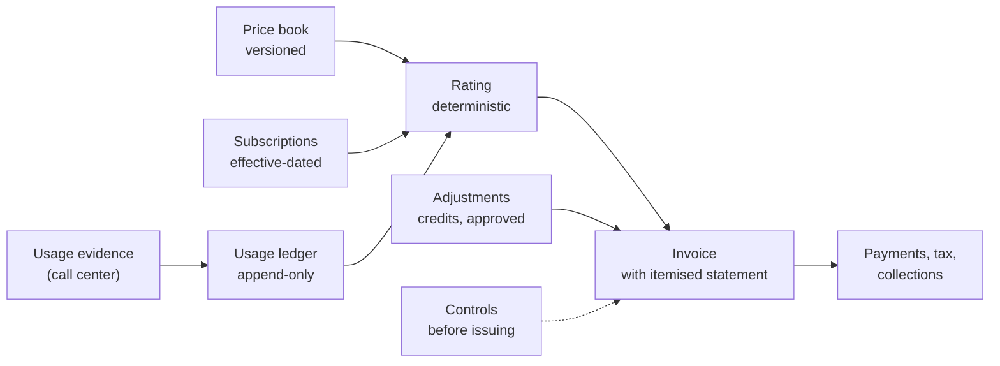

# Billing strategy

A billing model for Answering AI as a product suite: simple for firms to
understand, priced on what they value, and robust enough to stand up to an
investor's or acquirer's diligence. It sits with the [lead-delivery strategy](../lead-delivery/strategy.md):
billing is where
[call categories](../call-categories/why-it-matters.md) and
[delivery in time](../lead-delivery/README.md#window-to-act-and-fallback) become revenue.

Status: *Decided* (the decisions are in [answers.md](../lead-delivery/answers.md#billing)); built in steps. The legacy model is summarised in the appendix as lessons; the
billing system's code is not in this lab, so the appendix is drawn from its portal.

## 1. Goals

| Goal | Means |
|---|---|
| **Firms understand every invoice** | One line explains the price; every charge traces to calls they can see |
| **Price follows value** | Firms pay for real conversations handled, not for noise; the invoice shows what they got |
| **Every invoice can be recomputed** | Same inputs, same invoice, any time: auditable revenue |
| **Pricing is disciplined** | One versioned price book; exceptions are explicit, approved and time-limited |
| **Revenue grows with the suite** | Tiers and add-ons firms move up through, not one-off formulas |

## 2. Packaging: the suite in three tiers

| Tier | What it is | Includes |
|---|---|---|
| **Answer** | Answering AI takes every call and chat | Intake in the firm's call categories, after-hours coverage, the firm portal |
| **Deliver** | Every lead reaches the firm, in time, provably | Integrations (CRMs, Zapier, webhooks), fallback for the hand-off, proof of delivery, delivery support |
| **Insight** | The firm's calls as a business picture | The monthly statement and week in calls, practice-area trends, benchmarks against similar firms (aggregate only) |

**Answer** is the base. **Deliver** and **Insight** are tiers above it. Optional
add-ons: extra numbers, more languages, live transfer to the firm ("patching"),
and later an outcome add-on (section 3.3).

## 3. Pricing

### 3.1 The billable unit: a handled conversation

A **handled conversation** is a call or chat that Answering AI took and that
reached a person or produced a lead. It is what firms recognise as "a call we
got", it maps straight onto call categories, and it does not punish a firm for
long calls with good clients.

**Not billable, by rule (applied automatically, shown on the statement):**

| Rule | Example |
|---|---|
| Solicitation or vendor call | Call category `vendor` |
| Wrong number | Classified as wrong number at intake |
| Hang-up before a set time (for example 20 seconds) with no details given | A caller who hung up immediately |
| Repeat call from the same number within a set time (for example 10 minutes) | The caller rang back after being cut off |
| Test and system calls | Test leads, setup checks |

Each rule has an id and a version; every non-billable conversation in the ledger
records which rule made it free. Nobody marks calls free by hand; an operator who
disagrees issues a credit (section 4.4), which is recorded and approved.

**Fair use instead of minutes.** Talk time is not the price. Very long
conversations (say over 20 minutes) count as two, stated plainly in the terms,
which protects cost without billing every minute.

### 3.2 Plan structure

| Part | Rule |
|---|---|
| **Monthly subscription per tier** | Includes a number of handled conversations |
| **Overage** | A per-conversation rate set by the plan in the price book, the same for every firm on that plan version |
| **Annual commitment** | A discount for committing to a year, billed monthly or annually |
| **Pass-through costs** | Included in the price, not a separate line; if one must be shown, it is a published, standard fee |
| **Billing cycle** | One anchor per account set at signup; changes prorated by day |

### 3.3 Outcome pricing, later and optional

An add-on fee per **new matter delivered within its window to act** aligns price
with the firm's own value. It needs reliable categories and hand-off data first,
and a legal review: rules on paying for leads and on fee sharing vary by state.
Treat it as a later option, not the core.

## 4. How billing works: one ledger, deterministic invoices

### 4.1 Usage ledger

One append-only record per conversation, written when the conversation ends and
never edited. It prices the usage evidence the call center publishes for each
interaction (Proposed; [where this sits](../../README.md#where-this-sits)); billing
keeps no copy of its own of what happened on a call.

| Field | Purpose |
|---|---|
| Conversation id, firm, channel (call or chat), start and end time | Identity and usage |
| Call category, practice area | Value and no-charge rules |
| Billable or not, and the rule id and version that decided it | Every free call is explained |
| Lead id and its hand-off (on time, by fallback, expired) | Value shown on the statement |
| Price book version in force | The invoice can be recomputed |

The center's records feed delivery, the firm report and billing: **one source**, so
the invoice and what the firm sees always agree.

### 4.2 Price book and subscriptions

- **Price book:** plans, included volumes, overage rates, add-ons and fair-use rules, each a published, versioned entry. A change makes a new version; it never edits an old one.
- **Subscriptions:** which plan version each firm is on, from when, with which approved discounts. Effective-dated, so a change mid-cycle prorates cleanly.
- **Exceptions:** a discount is an explicit record with a reason, an approver, and an end date. There are no per-account formulas.

### 4.3 Rating and invoicing

- Rating is a pure function: **(ledger for the cycle, subscription, price book version) → invoice lines**. Running it twice gives the same invoice.
- Invoices are generated once per cycle per account, with a stable id, so a rerun cannot double-bill.
- Every invoice carries an **itemised statement**: conversations by call category, which were free and why, included against overage, and the value section (new matters by practice area, share reaching the firm in time).

### 4.4 Adjustments

Credits, refunds and dispute outcomes are **new ledger entries** with a reason and
an approver, never edits to usage or invoices. Credits above a set amount need a
second approver.

### 4.5 Controls before an invoice goes out

| Check | Catches |
|---|---|
| Every account on a current price-book version; no rate outside it | Configuration drift |
| Usage changed more than a set share against last cycle | Spikes, outages, misrouted numbers |
| Non-billable share above a set level | A rule misfiring, or abuse |
| Zero or negative invoices on active accounts | Broken subscriptions |
| Discounts past their end date | Forgotten exceptions |

Flagged invoices wait for review; the rest go out. Changes to the price book and
to rules require approval by someone other than the person who made them.

## 5. What firms experience

- **A live usage meter** in the portal: conversations this cycle against the plan, with notices at 80% and 100%.
- **A monthly statement** that reads like the firm report: what came in, what it meant, what was free and why, what it cost.
- **Self-serve plan changes**, prorated, with the new price shown before confirming.
- **Disputes in the portal**, each answered against the ledger record of the conversation.

## 6. Finance and diligence readiness

| Area | What to have in place |
|---|---|
| **Revenue recognition** | Subscription revenue recognised over the period, usage when delivered; finance confirms the policy against the applicable accounting standard |
| **Controls** | Separation of duties for price and rule changes; approval trail for credits; monthly reconciliation of invoices to the ledger |
| **Collections** | Card and bank payment, retries and dunning, clear suspension and reinstatement rules |
| **Tax** | Sales tax handled by the billing platform per jurisdiction |
| **Reporting** | Recurring revenue by tier, gross margin per conversation (carrier and AI cost against price), net revenue retention, churn, share of revenue on standard pricing, credits and disputes per 100 firms, revenue per new matter delivered |

## 7. Build or buy

- **Buy** invoicing, payments, tax and collections from an established subscription billing platform. They are commodities, and auditors know them.
- **Build** the usage ledger, the no-charge rules and the rating inputs. They are specific to Answering AI and depend on call categories and hand-off data, so they are built on the call center's usage evidence and lead, read through its contracts ([roadmap](../lead-delivery/strategy.md#5-roadmap)).

## 8. Moving from the legacy model

1. **Map** every legacy plan to a tier and plan version; list every account whose terms do not fit the price book, each with an owner and a decision (honour until a date, or move).
2. **Shadow-bill** for two cycles: rate every account under the new model alongside the legacy invoice, without charging; compare per account and explain every difference above a set amount.
3. **Communicate** with each firm before the switch: the new statement, what changes, and when.
4. **Switch** by cohort, starting with new accounts, then accounts whose price changes least.
5. **Retire** the legacy formulas and the "No Charge" call type once every account has moved.

## 9. What the rollout taught us

Problems met while bringing the current billing portal up, and the rule each one
gives the new model.

| Problem | Rule for the new model |
|---|---|
| Plan minutes were read from the product's name ("Plan 300" means 300 minutes); ranges or odd names could not be read | **Included volume is a number on the price book entry**, never parsed from a name |
| The overage rate was a free-text field, and some values were not numbers; the portal fell back to plan price ÷ plan minutes | **Every rate is a number in the price book**, validated on entry; nothing is derived from text |
| The cycle start (the 1st or the 15th) was inferred from the call platform's minutes period, while the billing system held the invoice date | **The billing account holds the cycle anchor**, one source; changes take effect from the next cycle |
| One customer with several clients on different cycle days needed a rule for its roll-up view | **Each billing account has one cycle;** a roll-up shows each account's own cycle rather than inventing a shared one |
| Past cycles were drawn from live settings, so a plan change would have rewritten history | **A closed cycle's statement is locked** as it was rated; later changes never alter it (built in the lab) |
| Nobody had decided whether a mid-cycle plan change applies now or next cycle | **An upgrade applies at once, prorated by day; a downgrade from the next cycle** (built in the lab) |
| The billing category was blank for almost every account because it was not imported; the portal was meant to be its source of truth | **Every billing field has one named system of record**, written down; imports seed it once, then edits happen only there |
| The no-charge allowance (10% by billing category, overridable per account) needed manual values per category | **Free calls by rule, not allowance**: no per-category percentages to maintain |
| About 120 accounts had data the formula could not use, so they were held back from the portal | **Readiness is a gate**: an account moves to the new billing only when its data passes, and the list of those not ready is a work queue (built in the lab) |
| Consumers of the billing data had to guess whether date ranges were inclusive, and to pull every account to get one cycle cohort | **The billing API states its conventions** (cycles are [from, to), dates inclusive where named) and filters by cycle day |

## 10. In the lab

Built on the same synthetic week as delivery, so billing and leads agree:

- **Firm portal**: the statement a firm's admin sees: estimated total, conversations billed and free (with the rule for each), included against used, the plan change split by day, new matters and hand-off in time beside the price, the previous cycle locked, and a working plan change.
- **Billing**: every account's current cycle under the new model beside the legacy formula; ready accounts, data problems and controls held for review; filtered by cycle day; the price book with its two versions.
- **Terms**: the price-book change announced as a terms version that asks firm admins to accept before it takes effect ([terms strategy](../terms/strategy.md)).

Prices are illustrative, talk time is synthetic, and nobody is charged.

## 11. Our answers

Every billing decision, with why and what would change it, is in
[answers.md](../lead-delivery/answers.md#billing): the billable unit, free-call
rules, packages and prices, pass-through costs, build or buy, outcome pricing,
migration, plan changes, locked cycles, and who owns each billing field.

## Appendix: lessons from the legacy model

From the billing portal's internal preview (November 2026; no customer details
reproduced). Each is a reason for a principle above.

| Legacy behaviour | Lesson | Principle |
|---|---|---|
| Billed minutes = (actual − no-charge allowance) × 1.33, the "wrap-up factor" for after-call work, set per billing category and overridable per account, shown only internally | Handling time billed as a hidden multiplier reads as a markup and invites disputes | Explainable on one line; handling time is in the price (3.1, 5) |
| A fixed $21.50 "carrier recovery" on every plan | A separate pass-through fee looks like a surcharge | Costs included in the price (3.2) |
| Overage rates from $0.01 to $2.60 a minute across plans; one 250-minute plan priced at $3.25 | Per-account terms drift, and nothing flags it | One price book, controls before invoicing (4.2, 4.5) |
| "No charge" set by choosing a call type during the call; one example ran 352 no-charge minutes against a 25-minute allowance | Free calls decided by a label are inconsistent and invisible | No-charge by rule, recorded with the rule (3.1) |
| One account: 1,091 calls averaging 29 seconds | Minute-based billing charges for, or absorbs, noise | Bill handled conversations (3.1) |
| Invoices computed from minutes, apart from leads and delivery | The bill cannot show the value delivered | One ledger with the value statement (4.1, 4.3) |
