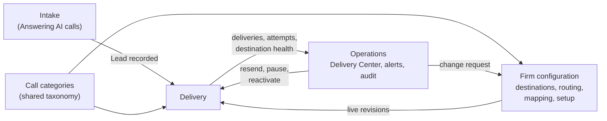
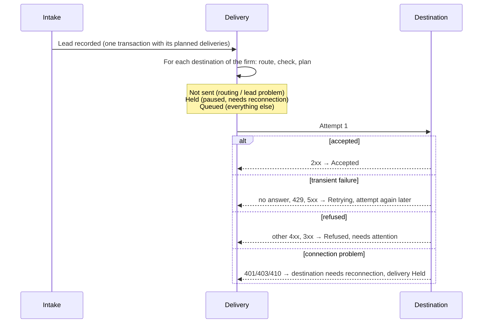
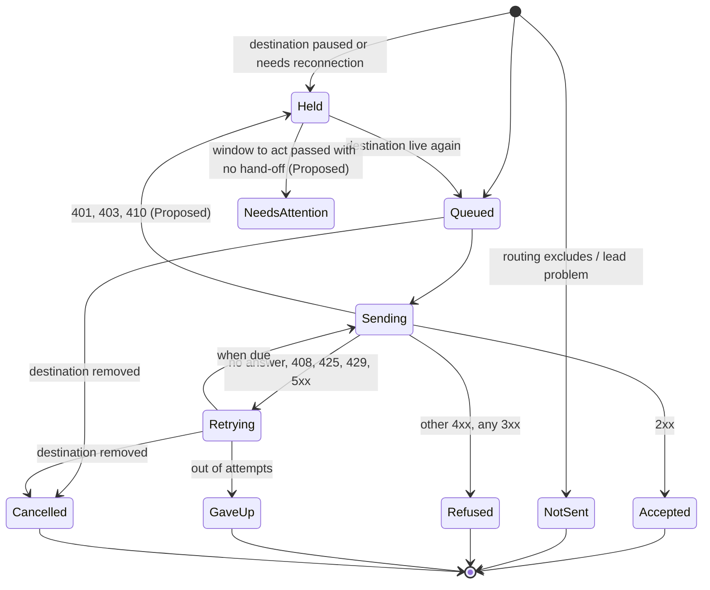
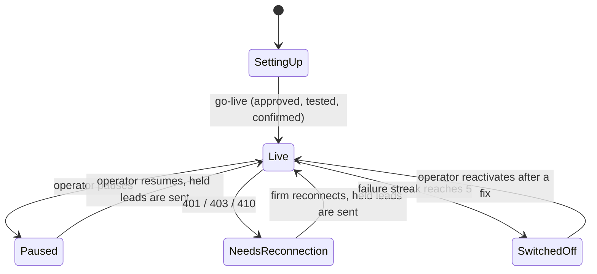

# Lead delivery: the domain model

How a lead should enter, be routed and be delivered, as the domain sees it.
Words in **bold** are defined in [GLOSSARY.md](../../GLOSSARY.md); use them as written.

Each fact lives in one document; the others link to it.

| Document | Holds | Read it when |
|---|---|---|
| [strategy.md](strategy.md) | What day-to-day operations hides, the direction (a platform for leads), the roadmap, operations and ownership, measures, and what we still assume | You want the big picture. **Start here** |
| [answers.md](answers.md) | **Every decision**, with why and what would change it: delivery, routing, categories, billing, terms | You need to know what we decided |
| [lessons.md](lessons.md) | What building the lab taught us, and what a 10/10 product needs | You are planning what to build next |
| This file | The domain model: contexts, aggregates, lifecycles, policies, invariants, events | You are changing a rule |
| [operations.md](operations.md) | What operators do, day to day and when something breaks; the console's screens and principles | You run or design the operator console |
| [production-today.md](production-today.md) | How api-2 delivers today, and its gaps against this model (evidence, not a plan) | You need to know what today's system does |
| [code-map.md](code-map.md) | Where each flow and screen lives in the code, in the order it runs | You are reading or changing the lab's code |

Elsewhere:

| Document | Holds |
|---|---|
| [GLOSSARY.md](../../GLOSSARY.md) | Every domain word, marked Lab, Production or Proposed |
| [call-categories/](../call-categories/README.md) | The taxonomy and its rules; [why-it-matters.md](../call-categories/why-it-matters.md) is the business case |
| [billing/strategy.md](../billing/strategy.md) | The billing model: packages, the real conversation, one record, controls, migration |
| [terms/strategy.md](../terms/strategy.md) | Terms of service: accepting, publishing a change, the record |
| [vision-meeting/](../vision-meeting/README.md) | The proposal to leadership, in screens, with a [one-page summary](../vision-meeting/summary.md). Written for management, so it restates the above in plain words |
| [api.md](../api.md) | The contract between the lab's backend and frontend |
| [rfc/](../rfc/README.md) | The proposals for approval, RFC-001 to RFC-006, one per body of work |

Each rule is marked **Lab** (built and tested here), **Production** (api-2 does
this today) or **Proposed** (agreed direction, not built). Onboarding and
change requests are specified in RFC-001
(`../airi/webhook-lab/docs/rfc/001_lead_delivery_and_client_integration.md`);
this model fits under it.

## 1. Contexts

| Context | Owns | Does not own |
|---|---|---|
| **Intake** (upstream) | The call, the **caller**, the **intake answers**, the chosen **call type** | Where the lead goes |
| **Firm configuration** | **Destinations**, **connections** (presence only), **routing rules**, **mappings**, **revisions**, **setups** | Sending |
| **Call categories** | The taxonomy that maps any **call type** to a **call category**, **practice area** and **modifiers** ([../call-categories/](../call-categories/README.md)) | Firm decisions about what to send |
| **Delivery** | **Deliveries**, **attempts**, retry and switch-off policy, **destination** health | What the firm wants (it reads live revisions) |
| **Operations** | What operators see and do, alerts, the audit trail | The rules; it acts through Delivery and Firm configuration |

Intake hands over a finished **lead**. From then on Intake is never asked again:
Delivery must work from what was recorded.

The contexts beyond delivery (accounts, usage and billing, terms), the
**hand-off** as an aggregate of its own, and the order features are built in are
proposed in [RFC-007](../rfc/007_domain_model_and_build_order.md). Evidence levels
for deliveries and hand-offs, the guarantee at each boundary, unknown outcomes,
and the split of a destination's state into desired state and observed health are
proposed in [RFC-008](../rfc/008_delivery_guarantees_and_evidence.md); until they
are approved, the rules below stand as written.

## 2. Aggregates

### Lead

A recorded call, unchangeable. Its identity travels with every **delivery** and
**resend**, so a destination that sees the same lead twice can recognise it.

- Belongs to one **firm**. Is a production lead or a **test lead**, never both.
- Carries the call type as the firm named it; its **call category** is derived, not stored by Intake.
- A **hang-up** is a lead like any other; whether a destination can take it is the destination's question.

### Destination

One place a firm's leads go. The aggregate root for everything about that place.

- Holds: **destination kind**, a **connection** (present or not, fingerprint), the live **revision** (routing rule and mapping), a draft revision if one is being prepared, its state, and its **failure streak**.
- State: Setting up → **Live**, and from Live to **Paused**, **Needs reconnection** or **Switched off** (section 4).
- Changes to the routing rule or mapping create a new revision; a revision goes live only through the setup or change-request workflow in RFC-001.

### Delivery

One lead to one destination. Owns its **attempts**.

- Created when a lead is recorded, one per destination the firm has at that moment, even if the decision is **Not sent** or **Held**.
- A lead has two jobs with different clocks: the **hand-off** (someone at the firm who can act, within the lead's **window to act**) and the **record** (the firm's system of record, complete, possibly late). A destination may do one or both; holding a delivery serves the record only. *Proposed.*
- A **resend** is a new delivery that points at the one it resends. The newest delivery for a (lead, destination) pair is the one that counts.
- Final states: **Accepted**, **Refused**, **Gave up**, **Not sent**, **Cancelled**. **Held** and **Retrying** are waiting states.

## 3. A lead's journey

1. **Recorded.** The lead is saved before anything is sent, together with one
   planned delivery per destination, in one transaction. Nothing can be lost
   between "we took the call" and "we tried to deliver it". *Lab. Production
   saves the lead, then posts inline in the same request.*
2. **Classified.** The call type maps to a call category (and practice area for
   new matters). *Lab.*
3. **Planned.** Each destination decides, in order:
   1. Destination **Paused** or **Needs reconnection** → **Held** for the record, and the hand-off goes to the firm's **fallback** at once. *Held is Proposed. The lab holds a delivery that was already waiting when its destination was paused (checked at send time; `pending`, no next attempt, reason "held: destination paused"; sent on resume), but a lead recorded while paused still gets no delivery (a missed lead), and production records nothing at all. Fallback is Lab.*
   2. Destination still Setting up → no production delivery (test leads only). *Lab.*
   3. **Routing rule** excludes it (category, practice area, or chat lead not wanted) → **Not sent**, with the reason. *Lab: by category where the destination has a rule; a CRM with no rule yet keeps the active call-type rule. Production routes by call-type text.*
   4. Lead lacks a field this destination requires (a hang-up to a CRM that needs a name) → **Not sent**, lead problem. *Lab. Production sends it and the destination refuses it.*

   Each step is recorded as the delivery's **routing decision** (planned, not sent for routing, or not sent for a lead problem), with the rule, classification and taxonomy version it used ([RFC-009 §3.2](../rfc/009_routing_by_category.md#32-the-routing-decision)). *Lab, without the revision: the lab's rule is a destination setting, not yet a revision.*
   5. Otherwise → queued.
4. **Sent.** Each queued delivery is attempted independently; one slow or broken
   destination never delays another. *Lab. Production posts to each CRM in turn,
   inside the intake request.*
5. **Resolved.** Each delivery ends Accepted, Refused, Gave up, Not sent or
   Cancelled, or waits as Retrying or Held. The **lead outcome** summarises them.

## 4. Lifecycles

### Delivery

`Refused` and `GaveUp` are **needs attention** until a later delivery for the
same (lead, destination) is accepted.

| Model state | Lab status (`deliveries.status`) | Lab UI label |
|---|---|---|
| Queued, Retrying | `pending` | Retrying |
| Sending | `delivering` | Sending |
| Accepted | `delivered` | Accepted |
| Refused, Gave up | `failed` | Needs attention |
| Not sent | `skipped` | Not sent |
| Cancelled | `cancelled` | Cancelled |
| Held | none (Proposed) | none |

### Destination

| Model state | Lab | Production (api-2) |
|---|---|---|
| Setting up | Setup not live; test leads only | Not modelled: a CRM row is enabled or not |
| Live | `status=active`, `enabled` | `enabled=true` |
| Paused | `enabled=false`: deliveries already waiting are held and sent on resume; leads recorded while paused get no delivery | `enabled=false` (leads get no record) |
| Needs reconnection | 410 → `disabled`; 401 counts toward the streak | Not modelled; token-refresh jobs run separately |
| Switched off | `disabled` after 5 failures in a row | Not modelled; one global alert |

### Lead outcome

Judged on the newest delivery to each destination, so a successful resend
clears an earlier refusal. *Lab rule, in this order:*

1. No deliveries → **No destination** (the firm had nowhere live to send it).
2. Any queued, retrying or sending → **In progress**.
3. Any refused, gave up or cancelled → **Needs attention**.
4. All not sent → **Not sent**.
5. Otherwise → **Accepted**.

**A lead the firm's routing sends nowhere** (every destination excluded it) owes no hand-off: it is never Expired, is not counted in the in-time numbers, and never goes to the fallback, which does not override routing. *Lab.* A lead with no live destination at all is still a missed window: that is a setup gap, not a choice.

*Proposed:* any held → **Held**, between 2 and 3. And a lead whose window to act
passed before any hand-off was accepted is **Expired**, whatever happens to its
record afterwards: the most serious outcome, shown first.

## 5. Policies

### Routing

- *Production:* if the lead's call type is not one of the firm's active call types (or the firm has none), the lead goes to none of its CRMs. It compares after trimming `" ,.;:-*"` from the ends and lowercasing, so "Personal-Injury" and "Personal Injury" differ.
- *Lab:* the routing rule is per destination and by **call category**: the categories it takes, optionally narrowed to practice areas for new matters ([RFC-009](../rfc/009_routing_by_category.md)). Each destination decides on its own; no order, no first match. A destination with no rule takes every lead, except a CRM, which keeps the legacy rule (the firm's active call types, ignoring all punctuation) until it has one.
- *Lab:* an imported CRM's rule is **seeded** from its firm's active call types, so nothing it receives changes: 117 of 122 active CRM firms get "new matters". A firm whose active call types split a category keeps the legacy rule and is listed in the import notes for review. A rule already on a destination is never overwritten by an import.
- *Production and Lab:* a destination can refuse chat leads.
- *Proposed:* the rule lives in the destination's revision and changes only by approval (RFC-001); uncertain classifications route wide ([RFC-008 §6.1](../rfc/008_delivery_guarantees_and_evidence.md#61-each-action-decides-on-its-own-terms)).

### Retry

*Lab, from webhook-lab:*

| Answer | Class | What happens |
|---|---|---|
| 2xx | | Accepted |
| No answer (timeout, DNS, refused connection) | Transient | Retry |
| 408, 425, 429, 5xx | Transient | Retry, never sooner than `Retry-After` |
| 3xx | Configuration | Refused: redirects are not followed |
| 410 | Connection | Destination stops (Proposed: needs reconnection, held) |
| 401, 403 | Connection | Lab: refused, counts toward the streak. Proposed: needs reconnection, held |
| Other 4xx | Configuration or lead | Refused |
| Body cannot be built | Our fault | Refused, without an attempt |

Schedule after the first attempt: 5 s, 1 min, 5 min, 30 min, 2 h, 6 h, 12 h, 24 h,
24 h (±20% jitter): 10 attempts over about 69 hours, most of the 72-hour window
to act. Set by Answering AI in [delivery-timing.json](delivery-timing.json).

*Production:* one attempt, no automatic retry; one manual resend per CRM lead.

### Switch-off

- *Lab:* 5 production deliveries in a row that end refused or gave up switch the destination off. An accepted delivery resets the streak. Test leads never count.
- *Lab:* a **lead problem** (a hang-up a CRM cannot take) is not sent, so it never reaches the destination or its streak.
- *Proposed:* only **configuration problems** and **gave up** count; a **connection problem** moves it to needs reconnection at once instead of after 5 lost leads.

### Window to act and fallback

A lead's value expires. In law a caller who is not called back quickly calls the
next firm, so a lead that reaches the CRM a day late has kept its record and lost
its client. Holding and retrying protect the **record**; they do nothing for the
**hand-off**. *Proposed:*

- **A window to act per call category,** agreed with firms (starting values to test, not measured):

  | Call category | Window to act | Fallback after |
  |---|---|---|
  | Emergency, jail or custody | 24 hours | 15 minutes |
  | Every other kind | 72 hours | 1 hour |

  Both are set by Answering AI, not by firms, in [delivery-timing.json](delivery-timing.json)
  ([answers](answers.md#speed-window-to-act-fallback-holding)).

- **The hand-off never waits for the record.** The hand-off goes to the firm's **fallback** **at once** when the destination that does it is paused or needs reconnection (its delivery is **held**), and **once its fallback delay has passed** (1 hour; 15 minutes for emergencies and custody) when nothing has been accepted yet, still retrying or refused. The fallback runs on **its own clock**, separate from the window to act ([answers](answers.md#speed-window-to-act-fallback-holding)). The fallback is a destination the firm agreed in its approved setup, usually email or SMS to its intake staff, marked "sent by fallback: {destination} unavailable". RFC-001 forbids silent rerouting, so a fallback is always pre-agreed and always shown.
- **The record carries on.** Retries continue on their schedule and held deliveries are sent when the destination returns, with the lead's original time. A lead past its window is marked late there and must never appear as a fresh lead (in a CRM, never a new "call back now" task).
- **An expired lead is the most serious event.** A lead whose window passed with no accepted hand-off goes to the top of the Delivery Center and alerts an operator, who tells the firm.

*Lab:* the windows and fallback delays above (`Urgency`, read from
`delivery-timing.json` by `Timing`), a hand-off on every lead (its first accepted
delivery against its window), the **Expired** outcome (shown as *reached late* or
*not reached in time*), and fallback: a destination marked `role: fallback` gets
no leads directly, and `Dispatch.runFallbacks` (every few seconds in the worker)
sends it any lead with no accepted delivery once its fallback delay has passed.
Not built: held deliveries for leads recorded while a destination is paused (they
still become missed leads), so the fallback for a stopped destination also waits
its delay instead of going at once.

## 6. Invariants

These must hold whatever the implementation.

1. **A lead is recorded before it is sent.** Nothing is lost between the call and the first attempt. *Lab.*
2. **Every destination gets a decision.** For each lead, each destination the firm had at that moment has a delivery, with a reason when it was not sent or is held. A lead never disappears silently from a destination's view. *Lab, except held. Production records nothing for routing or chat decisions.*
3. **A lead never changes.** Resends send the same lead under the same identity. *Lab.*
4. **Destinations are independent.** One destination's failure or slowness never delays or changes another's delivery. *Lab.*
5. **Tests are separate.** Test leads go only to the destination under test, never count toward health, streaks or totals, and are shown apart. *Lab.*
6. **Only live revisions take production leads.** A destination being set up receives test leads only. *Lab.*
7. **Accepted means accepted.** The system never says "in the CRM" because a receiver answered 2xx. **Verified in CRM** needs the firm or an API that allows it. *Lab.*
8. **Credentials are never stored or shown.** Only presence and a fingerprint. *Lab.*
9. **The hand-off never waits for the record.** No retry schedule, hold or reconnection delays getting a lead to someone who can act, within its window. *Proposed.*
10. **Every operator action is recorded** with who, when and why. *Lab for setups; Proposed for resend, pause and reactivate.*

## 7. Domain events

| Event | Raised by | Used for |
|---|---|---|
| LeadRecorded | Intake → Delivery | Planning deliveries |
| DeliveryPlanned / NotSent / Held | Delivery | Lead page, Delivery Center |
| AttemptMade | Delivery | Attempt history, received log |
| DeliveryAccepted | Delivery | Outcome, resets the failure streak |
| DeliveryRefused / DeliveryGaveUp | Delivery | Needs attention, failure streak |
| DestinationSwitchedOff | Delivery | Alert, disabled list |
| DestinationNeedsReconnection | Delivery | Alert to operator and firm contact (Proposed) |
| DestinationPaused / Resumed / Reactivated | Operations | Audit, sending held leads |
| LeadResent | Operations | Audit, new delivery |
| RevisionWentLive | Firm configuration | Routing and mapping in use from then on |

## 8. Decisions

The decisions this model needs (hang-ups to CRMs, windows to act, fallback,
routing by category, resending an accepted lead) are in
[answers.md](answers.md#speed-window-to-act-fallback-holding), with the reasoning
and what would change each.
