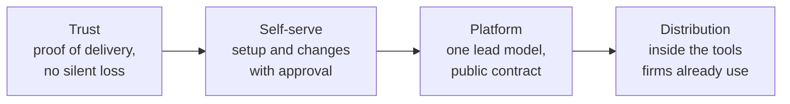
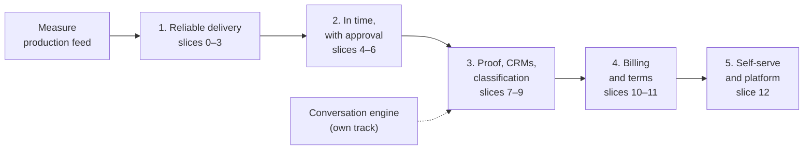

# Lead delivery: strategy

Why lead delivery has to change, where it should go, and in what order. This is
the one strategy document: what day-to-day operations hides, the direction (a
platform for leads), the roadmap, how operations changes, how we measure it, and
what we still assume.

| For | Read |
|---|---|
| What we decided, why, and what would change it | [answers.md](answers.md), the only place decisions are stated |
| What building the lab taught us about the product | [lessons.md](lessons.md) |
| The model the roadmap builds | [README.md](README.md), and for the whole product [RFC-007](../rfc/007_domain_model_and_build_order.md) |
| Each slice of the build, its tasks and effort | [RFC-007 §8](../rfc/007_domain_model_and_build_order.md#8-build-order-thirteen-vertical-slices) |
| How production works today, and its gaps against the model | [production-today.md](production-today.md) |
| The case for call categories | [why-it-matters.md](../call-categories/why-it-matters.md) |
| Billing and terms of service | [billing](../billing/strategy.md), [terms](../terms/strategy.md) |
| The version for leadership | [vision-meeting/](../vision-meeting/README.md) and its [one-page summary](../vision-meeting/summary.md) |

**How this was formed.** From the code of the source systems and a development
copy of their data, through this lab; not from conversations with firms or the
operations team. That copy may be a scrubbed restore and is mostly test traffic,
so every figure here is a signal to check, not a fact. The read-only production
feed, the roadmap's first step, replaces them with production numbers (section 8).

## 1. In one sentence

> **We are not short of effort; we are short of a standard: one lead, one set of call categories, one delivery service, one owner, and one number that says whether it worked, in time.**

Firms buy one thing from lead delivery: **every new client who calls reaches a
person at the firm, in time**. The main risk to it is **silent loss**, and loss
includes lateness. A stopped destination does not error; its leads simply stop
arriving, and today the firm usually notices before we do.

## 2. What day-to-day operations hides

Ten things that are hard to see while keeping operations running. Each gives the
everyday view, what lies underneath, what firms experience, and the evidence.
The answer to each is in [answers.md](answers.md).

### 2.1 Delivery is the product, but it is built like plumbing

- **Day to day:** we sell answered calls.
- **Underneath:** firms pay for **new matters arriving in their intake process**. A well-handled call that never reaches the firm is worth nothing to them.
- **Firms experience:** no proof that a lead arrived; they often learn of a loss before we do.
- **Evidence:** in production the last mile gets one attempt, inside the intake request, with no record of the leads it skips ([production-today.md](production-today.md)). The value is realised where the engineering is thinnest.

### 2.2 Most firefighting comes from variety we created

- **Day to day:** a stream of different problems, each one new.
- **Underneath:** the variety collapses. 4,390 call-type names across about 2,800 firms map to about a dozen [call categories](../call-categories/README.md); 99.8% of active ones mean "new matter". Almost every firm wants the same rule: *send me the new matters, tell me about the rest*.
- **Firms experience:** every setup and change is a support request; each firm is a bespoke configuration.
- **Evidence:** 9 hand-written CRM handlers, and several systems with their own lead shapes. The fires are what having no standard looks like.

### 2.3 We are flying blind, and busy feels like control

- **Day to day:** problems arrive from firms, and we fix them.
- **Underneath:** failures are silent. A stopped destination does not error, a skipped lead leaves no record, every exception reads as "500", and one global alert covers every firm.
- **Evidence:** nobody can say how many leads were lost last week, so there is no way to prioritise, and firefighting is the only mode available. Measurement is what turns firefighting into engineering.

### 2.4 The integration strategy rests on an untested assumption

- **Day to day:** firms need many CRM integrations.
- **Underneath:** in the copy we have, 8 of 444 CRM rows are enabled, one handler is switched off, and Clio accepted 0 of 71 (expired sign-ins). Either few firms want CRM delivery, or they tried, it broke, and they quietly gave up.
- **Firms experience:** an integration may be offered but not work.
- Both readings point away from "build more integrations" and towards "make a few work perfectly; cover the rest with email and Zapier". Not knowing costs engineering time spent maintaining what nobody uses.

### 2.5 The business is already bigger than law firms

- **Day to day:** a legal answering service.
- **Underneath:** the data includes heating, plumbing and investigation businesses. The core asset (lead intake, classification and delivery) is vertical-neutral; only practice areas are specific to law.
- **Firms experience:** non-legal customers get a model built for law.

### 2.6 We hold data nobody uses

- **Day to day:** call types are for routing.
- **Underneath:** the classified record of calls across about 5,500 firms: what kinds of matters arrive, how many, when. Aggregated (never caller details), it is proof of value at renewal, benchmarking for firms, and market insight.

### 2.7 Nobody owns the lead end to end

- **Day to day:** each team fixes what reaches it.
- **Underneath:** the systems grew one at a time: api-2, the chatbot, airi, the portals, voice. Fires are fixed where they surface, so the same problems return in different systems. Nobody owns a lead's whole life, from call to classification to delivery to proof. The root cause is not technical.
- **Firms experience:** the result depends on which system the lead went through. Voice, chat, api-2 and the portals each have their own lead shape, keys and delivery code; 18 chatbot firms share 4 keys.

### 2.8 A lead's value expires; holding it is not enough

- **Day to day:** a lead delivered eventually is a lead delivered.
- **Underneath:** in law, a caller not called back within minutes or hours calls the next firm. Delivery has two jobs with different clocks: the **hand-off** (someone who can act, in time) and the **record** (the CRM, complete, possibly late). See [window to act and fallback](README.md#window-to-act-and-fallback).
- **Evidence:** production does not retry at all; the lab first retried for about 21 hours and sent missed leads days later as if new. Neither had a **fallback** for when the usual destination cannot deliver in time. The lab now has one.

### 2.9 Call categories are the missing language

- **Day to day:** call types are a firm setting that switches CRM posting on or off.
- **Underneath:** they are the one place that says what each call *was*, and the field does four jobs: kinds of call (about 55%), system and billing flags (31%), staff names (9.8%) and phone handling (4.3%). 2,279 new-matter entries carry no practice area.
- As a standard language (category, practice area and modifiers, with the firm's own label kept), they drive routing, the window to act, intake questions and CRM fields, and become the value firms can see. The full case: [why-it-matters.md](../call-categories/why-it-matters.md).

### 2.10 We bill for minutes; firms buy clients

- **Day to day:** billing works; invoices go out.
- **Underneath:** the legacy bill is minutes × 1.33 (a hidden charge for after-call work), plus a carrier fee and account-by-account rates. "No charge" is a call type someone picks during the call. Nothing on the invoice shows the value delivered.
- **Firms experience:** they pay for hang-ups and sales calls, and cannot check the bill. The new model is in the [billing strategy](../billing/strategy.md); terms of service had the same "one rule for every change" problem ([terms](../terms/strategy.md)).

## 3. Three moves

| Move | What it means | Cost | Where |
|---|---|---|---|
| **1. Name an owner for the lead's whole life** | One accountable owner, judged by one number: leads handed off within their window to act, per firm, plus expired leads | An organisational decision; no code | Section 6 |
| **2. Measure before building** | A read-only, anonymised feed of production into the lab ([RFC-006](../rfc/006_integration_lab.md)): loss, CRM usage, the call mix. Settles 2.3 and 2.4 before the slices they size | Weeks; nothing in production changes | Section 5, alongside slice 0 |
| **3. Build to a standard** | The domain model built slice by slice ([RFC-007](../rfc/007_domain_model_and_build_order.md)): call categories instead of free-text call types; one lead shape for every channel; a short list of supported integrations. Each slice removes a class of fires, not one fire | Quarters, in slices | Section 5 |

## 4. Direction: a platform for leads

### 4.1 What "the Stripe, Slack or Teams of law firms" means

They are different strategies:

| | Strategy | Fit for us |
|---|---|---|
| **Stripe** | Make hard infrastructure invisible and trustworthy: one object model, a versioned API, signed webhooks with retries and replay, a test mode apart from live, a dashboard of every event | **Closest fit:** "every lead, delivered and provable". The lab already has early versions: test leads kept apart, signing, resend under the same identity, delivery history, failure classes |
| **Teams** | Win through distribution inside a suite customers already own | **Second:** be the intake layer inside the tools firms already use, through CRM marketplaces |
| **Slack** | Be where work arrives, with partners building on the platform | **Later, if at all:** it needs the platform first |

**Stripe first, then Teams-style distribution:** reliable lead infrastructure
with a public contract, reaching firms through the tools they already use.

### 4.2 What it means

**Product**

- **Proof of delivery shown to firms:** every lead, where it went, whether it was accepted and in time, in the firm's portal and a weekly report.
- **Self-serve setup and changes, with approval** (RFC-001 sections 4–6).
- **Call categories as the language of a call,** standard across firms, with each firm's own label kept.
- **A vertical-neutral core with vertical packs:** lead, call category and delivery are shared; practice areas (legal) or service lines (trades) sit on top.
- **A suite firms move up through:** Answer, Deliver, Insight ([billing](../billing/strategy.md#2-packaging-the-suite-in-three-tiers)).

**Platform**

- **One lead model and one delivery service** that every channel uses. Voice, chat and the portals become clients of it, not owners of their own copies. The model is in [README.md](README.md); the words are in [GLOSSARY.md](../../GLOSSARY.md).
- **A public, versioned contract:** the lead schema, plus signed webhooks with retries and replay. Zapier sits on top of it and covers the long tail, so a new tool no longer means a new handler.
- **A few deep native integrations, certified with their vendors,** chosen from real usage and described as catalog and mapping data, not code per CRM.
- **Trust as a feature:** credentials never stored (already a rule here), minimal data, audit trails, and in time a recognised security certification such as SOC 2.

**Engineering: build from the domain, slice by slice**

1. **Agree the contract first:** the lead schema and delivery states ([api.md](../api.md), [README.md](README.md)).
2. **Build the slices in order** ([RFC-007 §8](../rfc/007_domain_model_and_build_order.md#8-build-order-thirteen-vertical-slices)), each usable on its own and done only when its scenarios pass.
3. **Hold every implementation to the same guarantees and checks:** [RFC-007 §6](../rfc/007_domain_model_and_build_order.md#6-what-any-implementation-must-guarantee) and the [contract files](../contracts/README.md), whatever its language.
4. **Move firms and channels onto it one at a time,** behind a flag per firm; exactly one system sends a firm's leads.
5. **Retire each old path** once its firms have moved.

### 4.3 Sequence

- Proof of delivery earns the trust that self-serve depends on.
- Self-serve forces the single model the platform needs.
- The platform makes marketplace distribution cheap.

This repository covers the first step and the design of the second.

## 5. Roadmap

The roadmap is the build order of [RFC-007](../rfc/007_domain_model_and_build_order.md#8-build-order-thirteen-vertical-slices):
thirteen slices, grouped here into the milestones a firm or an operator would
notice. Each slice's tasks and effort are in
[RFC-007 §8](../rfc/007_domain_model_and_build_order.md#tasks-and-effort); this
section says what each milestone gives and why it comes in this order.

| Milestone | Slices | What firms and operators get | Why this order |
|---|---|---|---|
| **Measure** | Alongside slice 0 | The read-only production feed ([RFC-006](../rfc/006_integration_lab.md)): real loss, CRM usage, the call mix, call lengths | Replaces this document's assumptions with numbers that size the slices: how many CRMs slice 7 needs, the windows slice 6 uses, the free-call rules slice 10 applies |
| **1. Reliable delivery** | 0–3 | Real conversations taken in from today's chat and voice systems from the start; every lead recorded before it is sent; every destination gets a decision with a reason; retries, failure classes, destinations stopped and needing reconnection; resend; the Delivery Center and an alert per destination; one CRM certified end to end; firm isolation enforced from the first slice | Stops silent loss, the main risk; everything later is measured on deliveries that always end in a recorded state |
| **2. In time, with approval** | 4–6 | Call categories as the language of a call; routing by category; nothing a firm receives changes without its approval; the window to act, the fallback and held deliveries; proof of hand-off at two levels, accepted and confirmed, with escalation for emergencies | The product firms buy: every new client reaching a person in time. Fallback needs an approved revision, and windows need the taxonomy |
| **3. Proof, CRMs and classification** | 7–9 | The other CRMs firms use, chosen by demand and sandbox evidence; proof of delivery and the weekly report in the firm portal; Answering AI classifying each call as it takes it | Proof earns the trust self-serve depends on; classification at intake needs the conversation engine |
| **4. Billing and terms** | 10–11 | Billing per handled conversation with free-call rules, shadow bills beside the old ones; terms versions asked only of the users they concern | Billing reads conversations and the category set at intake |
| **5. Self-serve and platform** | 12 | Firms connect and approve destinations themselves; a published contract for other software; Zapier; benchmarks; a trades package | Builds on reliable, provable delivery; reduces onboarding and support load |

The conversation engine (the AI that takes calls and chats, one engine for both)
is a track of its own; milestones 1 and 2 run on real conversations taken in
from today's channels and do not wait for it. The guarantees each milestone must
prove, and the failure scenarios that gate production, are in
[RFC-008](../rfc/008_delivery_guarantees_and_evidence.md). Today's systems and their gaps against the model are recorded in
[production-today.md](production-today.md) as evidence, not as a plan.

**The lab's role throughout:** prove each slice against its scenarios
([contracts](../contracts/README.md)) before it ships. The lab is the reference
implementation (RFC-006, RFC-007 §10), so a change that breaks a scenario shows
up there first. What the lab still cannot prove is in [lessons.md](lessons.md).

## 6. Operations: scale through product, not headcount

- **One owner.** A lead delivery owner in Operations, judged by the measures in section 7.

  | Responsibility | Owner |
  |---|---|
  | Every lead from call to hand-off to proof; daily delivery health | Lead delivery owner (Operations) |
  | Destination setup and change requests (RFC-001 workflow) | Onboarding |
  | Our-fault failures, receivers that change behaviour | Engineering, on call |
  | Reconnecting a destination (sign in again, new key or hook) | Firm contact, from a reconnect link |

- **From reactive to proactive.** Today support hears about problems when a firm calls. The Destinations view, failure classes and alerts let operators find a stopped destination first. Alerts, failure classes and missed-lead recovery are what let one operator look after thousands of firms. The workflows are in [operations.md](operations.md).
- **After hours.** Calls arrive all night. Retries and the fallback work around the clock; urgent calls go to the fallback after 15 minutes, by text message; late leads are the first thing the owner sees the next morning.
- **Set up by category.** New firms choose call categories instead of writing free-text call types. Existing call types are already mapped; each firm confirms its mapping once.

## 7. Measures

**The one number** (internally the delivery service level; shown to firms, proof
of delivery):

> **Share of leads handed off within their window to act**, per firm (new matters and emergencies first; a fallback counts if it was accepted in time), and the number of **expired leads**.

| Measure | Shows |
|---|---|
| Missed leads per week | Silent loss |
| Expired leads per week | Loss through lateness, the kind holding cannot fix |
| Time to detect a stopped destination | Whether we find problems before firms do |
| Time from signup to first delivered lead | Onboarding friction |
| Share of setups done self-serve | Whether cost scales with software or people |
| Support tickets per 100 firms | The overall operating cost of delivery |

### How this serves the company's goals

The goal: a product suite ready to scale, and to stand up to an investor's or
acquirer's diligence.

| What diligence and growth require | What this work gives | Measured by |
|---|---|---|
| **Predictable, explainable revenue** | Packages billed per real conversation from one record; invoices anyone can recompute; one price list | Recurring revenue by package; share of revenue on standard pricing; disputes per 100 firms |
| **Retention** | Proof of delivery, no silent loss, a weekly report of the firm's calls as matters | Net revenue retention; churn; expired leads per firm |
| **Margin that improves with scale** | Standard rules and operator tooling, so support does not grow with the number of firms | Support tickets per 100 firms; gross margin per conversation |
| **A defensible product** | Call categories as the language of every call; delivery in time with fallback; benchmarks no single firm can build | Leads handed off in time; Insight adoption |
| **Room to grow** | A vertical-neutral core with vertical packs; a public contract and Zapier for the long tail | Firms outside law; integrations reached without new code |
| **Operational control** | One owner, alerts per destination, an audit trail of every operator action | Time to detect a stopped destination |

## 8. What we know, what we assume, and how we check

| Area | Confident | Assumed, and how we check |
|---|---|---|
| **Call categories** | 4,390 names reduce to about a dozen categories; 99.8% of active call types are new matters; the F# and Python rules agree on the same reference leads | How calls really split across categories (the simulator's mix is invented): the production feed. Whether firms accept the mapping and value seeing their calls as matters: show five firms their own report. What to do with staff names: a staff directory ([answers](answers.md#call-categories)) |
| **Delivery model** | Record first, one delivery per destination, retry transient failures, stop on 401/403/410, failure classes, resend under the same lead identity: established webhook practice, exercised on every path by the simulated week | Real failure rates (the copy shows 43% of 476 CRM deliveries failed, mostly test traffic): the production feed, then the first slices' own delivery records |
| **Production today** | The gaps, read from the api-2 source: one attempt; routing leaves no record; every exception is "500"; one global alert | How many leads they lose, and whether the possible double-post path is live: the production feed |
| **Integrations** | Which kinds have working builders | That CRM delivery is rare (2.4): enabled destinations and accepted deliveries per CRM in the production feed |
| **Speed** | Lateness loses clients in law | The starting windows to act: ask firms; measure call-to-first-contact where firms record it |
| **Routing** | The default rule reproduces today's behaviour | That firms want "new matters to the CRM, the rest by email": ask five firms |
| **Other verticals** | They are already customers | That they are worth serving: revenue and pipeline from non-legal firms in production data |
| **Billing** | The legacy formula and its data problems | Talk time, the free-call thresholds and the prices: real call data and the two months of side-by-side bills |

Production numbers could reverse "CRM integration is rare" (and so the
integration strategy), show silent loss is smaller or larger than the gaps
suggest (and so the urgency), or change which categories routing cares about.
Any answer they overturn is revised in [answers.md](answers.md), and this page
with it. The real situations to walk through with operations and firms to test them are
in [discovery scenarios](../discovery/scenarios.md).
