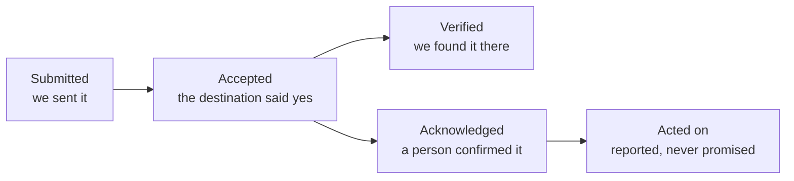

# Lead delivery: what it means, and how we guarantee it

The model behind every rule in this repository, in one place. The rules themselves
live in [answers.md](answers.md) and [RFC-008](../rfc/008_delivery_guarantees_and_evidence.md);
this explains why they are the rules.

## 1. What we are actually selling

A law firm does not pay Answering AI to answer the phone. It pays us so that **no
client is lost because nobody picked up**. A caller with a new matter will call the
next firm on the list within hours, often minutes. So a lead is perishable: its value
decays with time, and it is worth nothing if it reaches the firm after the caller has
hired someone else.

That makes our real product a **hand-off**: a person at the firm who can act on this
caller, while the caller is still theirs to win. Everything else, the CRM record
included, supports that.

> **Lead delivery** is the promise that every lead we take reaches someone at the
> firm who can act on it, within the time its kind of call allows, and that we can
> prove it did.

## 2. Two jobs, with opposite instincts

Every lead has two jobs, and they pull in different directions:

| | The hand-off | The record |
|---|---|---|
| What it is | A person at the firm knows about the caller | The lead is in the firm's system (usually its CRM), complete |
| Deadline | The window to act: 24 hours for emergencies and custody, 72 for the rest | None: it can be late |
| Worst failure | Nobody knew in time | A missing or duplicate record |
| Instinct | **Redundancy.** Send it again, send it another way, call the firm | **Restraint.** Exactly once; check before resending |
| Routes | Email, SMS, Slack: things a person reads | CRMs, webhooks: things a system stores |

Most of our design follows from keeping these apart. A second email is harmless and
may save the hand-off; a second CRM record is a mess the firm must clean up. So the
same event (a send we never heard back from) means "send again" for email and "stop and
check" for a CRM.

## 3. Why it is hard: four kinds of not knowing

We control our own database. We do not control the other end, and at each step there
is something we cannot see:

1. **Did it arrive?** A request can time out after the CRM made the record. Silence is not failure.
2. **Did it stay?** A CRM can accept a lead and lose it.
3. **Did anyone see it?** An email accepted by a mail server is not a person reading it.
4. **Will they take it at all?** A sign-in expires, a hook is deleted, a required field is missing.

The first is not a bug we can fix: no system can make a request to someone else's
server and its own record happen as one indivisible act. A crash can always fall
between "sent" and "heard back". So **unknown** is a real outcome, and an honest system
says so instead of guessing.

## 4. What "guarantee" can honestly mean

Because of section 3, a guarantee is not one thing. We make four kinds of promise, and
it matters which is which:

| Kind | What we promise | How |
|---|---|---|
| **Absolute**: fully in our control | We never lose a lead we said we recorded. We never send to a destination after an operator's pause has taken effect. We never claim a delivery we cannot evidence. One call is one lead. Every decision is recorded with why | Atomic recording, versioned leases, evidence written with every change; proved by tests that try every ordering of events |
| **Persistent**: bounded by time | Within the window to act we keep trying: retries for about 69 hours, the firm's fallback after 15 minutes (urgent) or an hour, then a person calls the firm | Retry schedule, agreed fallback, escalation |
| **Cooperative**: needs the destination | No duplicate records in a CRM | Only where the CRM lets us check (an idempotency key or a lookup). Everywhere else an operator decides, after looking |
| **Measured**: never promised | A person at the firm confirmed it; the firm acted on it | The confirmation link, CRM lookups, reported side by side with "accepted" |

The line we hold: **we promise the floor and measure the rest.** The floor is that
every lead is accepted by a route the firm agreed to, in time. Above it we report how
much more we can prove, never merged into one flattering number.

## 5. Evidence, not status

A delivery is not "done" or "not done". It has a level of proof:

Verified and acknowledged are separate branches: a CRM can be checked by lookup but
cannot tell us a person saw the lead; an email can carry a confirm link but cannot be
looked up. When a firm says "we never got it", the answer is this evidence: what was
sent, when, by which route, what the destination said, and who decided anything along
the way.

## 6. How the guarantee is built

Each mechanism exists to keep one promise. Read the list as principles; the code is
one way of keeping them.

1. **Record before you act.** A lead and its planned deliveries are written together, before anything is sent. If we cannot record it, we tell the channel so, and it sends again.
2. **Decide once, and say why.** Where a lead goes is decided when it arrives, by the rule then in force, and the decision is kept with the rule's version.
3. **One worker at a time, and a stale worker can do nothing.** A worker claims a delivery with a numbered lease; every later step checks the number. A worker that stalled and lost its claim cannot overwrite anything.
4. **Write down "I am about to send" before sending.** Then a lost answer is known to be unknown, not mistaken for "never sent".
5. **Treat silence by what a repeat would cost.** Unknown at email: send again. Unknown at a CRM: look it up if it can be looked up, otherwise a person checks.
6. **More than one road to a person.** The usual destination, then the firm's agreed fallback, then a person who calls the firm. A paused or broken destination sends the hand-off to the fallback at once.
7. **People close what machines cannot, and their decisions stand.** An operator resolves an unknown outcome; a later answer does not silently undo it. Resending an accepted lead takes a senior operator and a reason.
8. **One firm's trouble stays its own.** A slow CRM holds a few send slots, not all of them; a firm with a backlog cannot hide another firm's lead.
9. **Prove it, don't assert it.** Every rule is an executable scenario; every destination kind has a contract checked against the code; the core is checked against every ordering of events up to a bound.

## 7. What the guarantee is not

Saying these plainly prevents the most expensive misunderstandings:

- **Not exactly once in every CRM.** Where a CRM cannot tell us whether it already has a lead, no system can promise one copy; we promise not to guess.
- **Not that a lawyer read it.** We can prove a person confirmed receipt where the firm uses the confirmation link; otherwise we prove acceptance.
- **Not instant.** It is "within the window to act", and a fallback when the usual route is late.
- **Not independent of the firm.** A firm with no fallback and a broken CRM will miss leads; the system will show exactly when and why, and operators will see it first.

## 8. What this means for how we work

- **Sell the hand-off, with proof.** "Reached your intake team within the hour, and here is the evidence" is the product, not "integrates with your CRM".
- **Every firm needs a route to a person.** A CRM-only firm needs an agreed fallback (SMS or email) in its setup.
- **Someone owns the unknowns.** Unknown outcomes and escalations are decisions for a person, every day, including out of hours.
- **Certify CRMs one at a time.** Each one's sandbox tells us whether it can be looked up and how it handles a repeat; that moves it from "an operator checks" to "the system checks".
- **Report two numbers, never one.** Accepted in time (every lead), and confirmed in time (where the firm can confirm), side by side, per firm.

For how this is built and proved: [concurrency.md](concurrency.md) and its
[explorer](concurrency-explorer.html), the [scenario contracts](../contracts/README.md),
and what we still assume in [strategy §8](strategy.md#8-what-we-know-what-we-assume-and-how-we-check).
