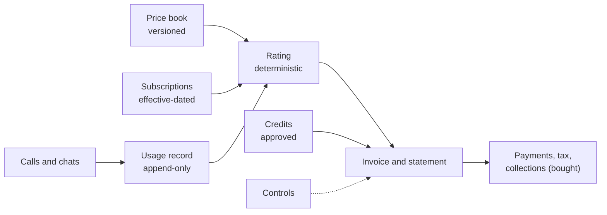

# RFC-003: Billing on Value

**Answering AI — Product and Technical Proposal**

**Date:** November 19, 2026
**Status:** Proposed — Awaiting stakeholder approval
**Decision owner:** Finance / Product Leadership
**Reviewers:** Finance, Billing Operations, Sales, Customer Success, Engineering, Legal, Management
**Related:** RFC-001 (hand-off data on the statement) · RFC-002 (free-call rules by category) · RFC-004 (price changes accepted through the terms)
**Detail:** [billing strategy](../billing/strategy.md) · [answers](../lead-delivery/answers.md#billing)

---

## 1. Executive Summary

Answering AI bills by the minute, with a hidden multiplier, a separate carrier
fee, account-by-account rates, and free calls decided by a label someone types.
Nothing on the invoice shows what the firm received, and the bill cannot be
recomputed from the calls.

**We propose three packages (Answer, Deliver, Insight), priced per handled
conversation, rated from one append-only record of every conversation, with
free calls decided by published rules, and a move from the legacy model only
after two months of side-by-side bills.**

### Recommended decision

Approve:

1. **Three packages**, each a monthly subscription with included conversations and one overage rate per plan version.
2. **The handled conversation** as the billable unit, with free-call rules recorded on every conversation.
3. **One usage record and one versioned price book**; invoices recomputable and locked once a cycle closes.
4. **Controls** before any invoice goes out.
5. **Buy** invoicing, payments, tax and collections; **build** the usage record and the rules.
6. **Shadow billing for two cycles**, then a switch by group.

---

## 2. Problem Statement

### The legacy model

| Legacy behaviour | Consequence |
|---|---|
| Billed minutes = (actual − free allowance) × 1.33, a "wrap-up factor" for after-call work, shown only internally | Reads as a hidden markup; invites disputes |
| A fixed $21.50 "carrier recovery" on every plan | Looks like a surcharge |
| Overage rates from $0.01 to $2.60 a minute; one 250-minute plan priced at $3.25 | Per-account terms drift, and nothing flags it |
| "No charge" set by choosing a call type during the call; one account ran 352 free minutes against a 25-minute allowance | Free calls are inconsistent and invisible |
| One account: 1,091 calls averaging 29 seconds | Minute billing charges for, or absorbs, noise |
| Invoices computed from minutes, apart from leads and delivery | The bill cannot show the value delivered |

### What the current billing portal rollout ran into

| Problem | Rule it gives |
|---|---|
| Plan minutes read from the product's name ("Plan 300") | Included volume is a number in the price book |
| Overage rates stored as free text, some not numbers | Every rate is a validated number |
| The cycle start inferred from another system | The billing account holds the cycle anchor |
| Past cycles drawn from live settings | A closed cycle is locked as rated |
| No rule for a plan change mid-cycle | Upgrades now, prorated; downgrades next cycle |
| The billing category blank for almost every account | One named system of record per billing field |
| About 120 accounts with data the formula could not use | Readiness is a gate, and the not-ready list a work queue |

### Business impact

Disputes, invisible revenue risk in per-account formulas, and revenue that
cannot be explained to a firm, an auditor or an acquirer.

---

## 3. Product Vision

**Firms pay for what they recognise, see what they got, and can check every line.**

### Packages

| Package | What it is | Includes |
|---|---|---|
| **Answer** | Answering AI takes every call and chat | Intake in the firm's call categories, after-hours coverage, the firm portal |
| **Deliver** | Every lead reaches the firm, in time, provably | Integrations, fallback, proof of delivery, delivery support (RFC-001) |
| **Insight** | The firm's calls as a business picture | Weekly report, trends by area of law, benchmarks (RFC-002) |

Add-ons: extra numbers, more languages, live transfer. Outcome pricing (per new
matter delivered in time) is a later option, not the core.

### What firms experience

- **A live usage meter**: conversations this cycle against the plan, with notices at 80% and 100%.
- **A statement** that reads like the firm report: what came in, what was free and why, what it cost, and what the firm got (new clients, leads in time).
- **Self-serve plan changes**, with the new price shown before confirming.
- **Disputes in the portal**, answered from the record of the conversation.

---

## 4. Pricing Model

### 4.1 The handled conversation

A call or chat that Answering AI took and that reached a person or produced a
lead.

**Free by rule** (applied automatically, shown on the statement):

| Rule | Example |
|---|---|
| Solicitation or vendor call | Category `vendor` |
| Wrong number | Classified at intake |
| Hang-up under 20 seconds with no details given | A caller who hung up at once |
| Repeat call from the same number within 10 minutes | A caller cut off who rang back |
| Test and system calls | Test leads, setup checks |

Each rule has an id and a version; every free conversation records which rule
made it free. Nobody marks calls free by hand; a disagreement becomes an
approved credit. **Fair use:** a conversation over 20 minutes counts as two.

### 4.2 Plan structure

| Part | Rule |
|---|---|
| Subscription per package | Includes a number of conversations |
| Overage | One per-conversation rate per plan version, the same for every firm on it |
| Annual commitment | A discount, billed monthly or annually |
| Pass-through costs | In the price; no separate line |
| Cycle | One anchor per account (the 1st or the 15th) |
| Plan change | An upgrade applies at once, prorated by day; a downgrade from the next cycle |
| Prices | Set from cost per conversation and what accounts pay today; published as numbered price-book versions |

---

## 5. How Billing Works

- **Usage record:** one row per conversation, written when it ends, never edited: firm, channel, times, category and practice area, billable or not with the rule and version, the lead and its hand-off, the price-book version. The same record feeds delivery, the firm report and billing.
- **Price book:** plans, included volumes, rates, add-ons and fair-use rules as versioned entries; a change is a new version, never an edit.
- **Subscriptions:** which plan version a firm is on, from when, with which approved discounts; each discount has a reason, an approver and an end date.
- **Rating:** a pure function of (usage, subscription, price book) → invoice lines. Same inputs, same invoice.
- **Closed cycles are locked:** later plan or price changes never rewrite a statement a firm has seen.
- **Credits** are new entries with a reason and approver; above a set amount, two approvers.

### Controls before an invoice goes out

| Check | Catches |
|---|---|
| Account without a current plan, or a rate outside the price book | Configuration drift |
| Usage changed sharply against last cycle | Spikes, outages, misrouted numbers |
| Free share above a set level | A rule misfiring, or abuse |
| Zero or negative invoices on active accounts | Broken subscriptions |
| Discounts past their end date | Forgotten exceptions |

Flagged invoices wait for review; the rest go out. Price-book and rule changes
need approval by someone other than their author.

---

## 6. Technical Approach

- **Buy** a subscription billing platform for invoicing, payments, tax, dunning and collections: commodities that auditors know.
- **Build** the usage record, free-call rules and rating inputs with the lead platform: they depend on call categories and hand-off data (RFC-002, RFC-005).
- **One system of record per billing field** (plan, price, cycle anchor, category), written down; imports seed once, edits happen only there.
- **The billing API states its conventions:** cycles are [from, to); filters by cycle day.

Built in the lab on the same synthetic week as delivery: the price book with two
versions, subscriptions with proration, the firm's statement and meter, locked
previous cycles, a working plan change, and Billing operations (every account's
bill both ways, readiness, controls, filtered by cycle day). Prices are
illustrative; talk time is synthetic; nobody is charged.

---

## 7. Migration and Rollout

| Phase | When | Deliver |
|---|---|---|
| **1. Audit** | Weeks 1–2 | Every account on unusual terms listed with an owner; past cycles locked |
| **2. Clean** | Weeks 3–8 | Price list and free-call rules written down; billing data as numbers, not text; one system of record per field |
| **3. Shadow** | Months 3–5 | The usage record; every account rated both ways for two cycles without charging; every difference above a set amount explained |
| **4. Switch** | After | Firms told first; switch by group: new accounts, then those whose price changes least; contracts honoured to their end date |
| **5. Retire** | After all moved | Legacy formulas and the "No Charge" call type removed |

### Out of scope

- Outcome pricing (per new client delivered), until two quarters of hand-off data and a legal review.
- Building payments, tax or collections.

---

## 8. Success Criteria

| Metric | Proposed target |
|---|---|
| Accounts passing readiness checks | All active accounts before their switch |
| Share of revenue on standard price-book plans | 90% within two cycles of the switch |
| Shadow-bill differences explained | 100% above the threshold |
| Billing disputes per 100 firms | Below the legacy baseline, measured in phase 1 |
| Invoices recomputable from the record | 100% |
| Gross margin per conversation | Reported monthly by package |

---

## 9. Key Risks and Mitigations

**Revenue loss on the switch.** *Mitigation:* two cycles side by side; prices set from what accounts pay today; the audit finds under-charging as well as over-charging.

**Firms surprised by a new bill.** *Mitigation:* every change explained before it is charged; price changes accepted by firm admins with notice (RFC-004).

**Thresholds wrong** (20 seconds, 10 minutes, 20 minutes). *Mitigation:* set from real call data in the shadow phase; versioned rules.

**Classification drives billing.** *Mitigation:* free-call rules use conservative categories; disputes resolved by credit, recorded.

**Revenue recognition.** *Mitigation:* finance confirms the policy against the applicable standard before the switch.

---

## 10. Decisions and Approval Request

| # | Decision | Proposed resolution |
|---|---|---|
| D1 | Packages | Answer, Deliver, Insight; subscription with included conversations; one overage rate per plan version |
| D2 | Billable unit | Handled conversation; free by published rule; over 20 minutes counts as two |
| D3 | Legacy multiplier and carrier fee | Folded into the new prices |
| D4 | Accounts on unusual terms | Audited in two weeks; each with an owner; moved within two cycles unless a contract says otherwise |
| D5 | Build or buy | Buy invoicing, payments, tax, collections; build the usage record and rules |
| D6 | Migration | Shadow-bill two cycles, then switch by group |
| D7 | Plan changes | Upgrade now, prorated; downgrade next cycle |
| D8 | Past cycles | Locked as rated |
| D9 | Billing data | One system of record per field |
| D10 | Outcome pricing | Not now |

The reasoning, and what would change each: [answers.md](../lead-delivery/answers.md#billing).

### Approval requested

1. The package and pricing direction.
2. Phases 1–2 now; the shadow phase with the usage record.
3. Selection of a billing platform.

### Specialist sign-off

- **Finance:** revenue recognition, controls, approval thresholds.
- **Legal:** fair-use wording; outcome pricing (later).
- **Sales:** package contents and prices.
- **Tax:** handled by the bought platform, confirmed per jurisdiction.

---

## 11. Next Steps

1. List every account on unusual terms, with an owner.
2. Write down the price list and free-call rules as versioned entries.
3. Shortlist billing platforms.
4. Specify the usage record with the lead-format work (RFC-005).

---

## Final Recommendation

**Bill on the conversations firms recognise, from one record anyone can check, and change nobody's bill until it has run beside the old one.**

**Guiding principle: every charge traces to a call the firm can see, and every free call says why.**
