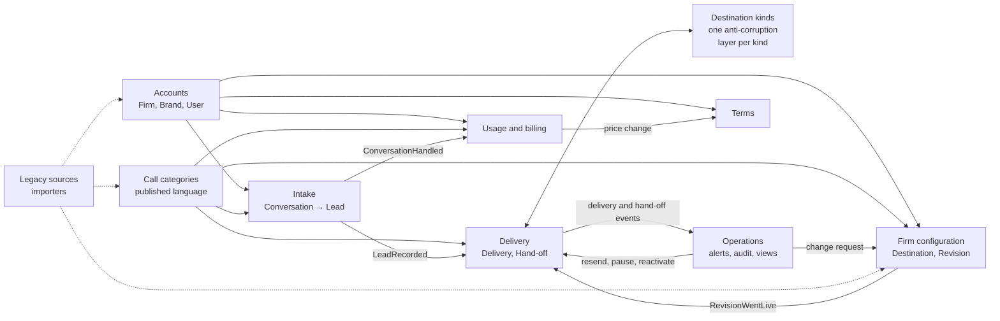
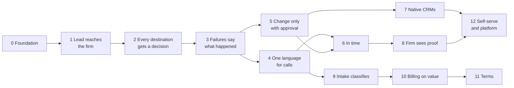

# RFC-007: The Domain Model and the Order to Build It

**Answering AI — Product and Technical Proposal**

**Date:** November 19, 2026
**Status:** Proposed — Awaiting stakeholder approval
**Decision owner:** Engineering / Product Leadership
**Reviewers:** Engineering, Product, Operations, Finance, Legal
**Related:** RFC-001 to RFC-005 (each is one or more slices here) · RFC-006 (the lab is where each slice is proven)
**Detail:** [domain model: delivery](../lead-delivery/README.md) · [glossary](../../GLOSSARY.md) · [answers](../lead-delivery/answers.md) · [lessons](../lead-delivery/lessons.md) · [code map](../lead-delivery/code-map.md)

---

## 1. Executive Summary

RFC-001 to RFC-005 say **what** lead delivery, call categories, billing and terms
should do. This RFC says **how the product is shaped and in what order its
features are built**, so that anyone could rebuild it the right way: a new
team building the product, or the lab itself as its reference.

The thought experiment behind it: *if the team and every codebase were gone
tomorrow, what would we need to rebuild every feature correctly, one at a time?*
The answer is not the code. It is the domain knowledge this repository already
holds: the glossary, the delivery model with its invariants, the decisions with
their reasons, the operator workflows, and the named scenarios that show each
rule working. What it lacks is a model for the contexts beyond delivery, a
build order, and one method each feature follows.

**We propose one domain model for the whole product (nine bounded contexts with
named aggregates, invariants and events), a build order of thirteen vertical
slices that each give a firm or an operator something usable, and one method
every slice follows: words, rule, scenario, pure decision, read model, contract,
screen.**

### Recommended decision

Approve:

1. **The context map** (section 4): nine contexts, the language between them, and what each owns.
2. **The aggregates and invariants** (section 5), including three corrections to today's model: the **hand-off** as its own aggregate, **classification recorded at intake**, and **billing read from conversations, not leads**.
3. **The build order** (section 8): thirteen slices, each with the scenario that proves it and its estimated effort (about 60–90 person-weeks in all; 24–35 to a product a firm can rely on).
4. **The method** (section 9) as the definition of done for every feature.
5. **The guarantees every implementation must keep** (section 6), whatever its language or infrastructure, and **scenarios and receiver contracts as language-neutral data files** that any implementation can be checked against.
6. **Refactoring the lab towards this model** (section 10), slice by slice, as the reference implementation.

---

## 2. Problem Statement

### 2.1 The knowledge is in documents, not in a shape

Every production system that handles leads (api-2, the chat system, the voice
platform, the portals) has its own lead shape, its own idea of a firm and its own
delivery code ([strategy §2.7](../lead-delivery/strategy.md#27-nobody-owns-the-lead-end-to-end)).
The lab replaced several of them with one model, but only for delivery:
[README.md](../lead-delivery/README.md) defines contexts, aggregates, lifecycles,
invariants and events for **Intake → Delivery → Operations**, and stops there.
Billing, terms, classification at intake and firm identity were built in the lab
without a model of their own.

### 2.2 The lab's code drifted from its own model

The lab was built to explore, and it shows. Each item below is a place where the
code says something different from the model, and each made a later feature
harder:

| Drift | Where | Cost |
|---|---|---|
| **API shapes used as domain types.** States are strings, and one delivery carries its state twice (`Status` and `Stage`) | [Domain.fs](../../backend/src/Core/Domain.fs) | The README needs a table mapping model states to lab states; invalid states are representable |
| **Destination, connection and health in one type.** `Connection` holds the destination, its authorization, its state and its failure streak | `Domain.Connection` | The glossary's most important distinction (a destination is not its connection) is not in the code ([code map: names](../lead-delivery/code-map.md#names-the-code-still-uses)) |
| **Revisions belong to the setup, not the destination.** `Setup` holds the active revision and its versions | `Domain.Setup`, `Onboarding.fs` | Changing a live destination means going through its onboarding record |
| **Category derived when read.** The lead carries only the firm's call type; the category is computed from it each time | `Categories.fs`, README §2 ("derived, not stored") | Contradicts the decision to classify at intake ([answers](../lead-delivery/answers.md#call-categories)); a taxonomy change silently reclassifies history |
| **Hand-off inferred.** "In time" is the first accepted delivery compared with the window | `Urgency.fs`, `Dispatch.runFallbacks` | The one number the business is judged by has no record of its own |
| **Billing built from leads.** Conversations are derived from lead events with synthetic talk time | `Billing.conversations` | A wrong number or a hang-up is a conversation but not always a lead; billing cannot be right while it reads delivery's input |
| **HTTP in the domain.** Domain failures carry an HTTP status | `exception Fail of status` | Rules cannot be reused outside the API |
| **One store for every context** | `Store.fs` (873 lines) | Every context can read every table; boundaries exist only in documents |
| **The simulator re-implements the rules** | `Simulate.fs` ([lessons §5](../lead-delivery/lessons.md#5-the-demo-data-became-a-product-of-its-own)) | Kept honest only by sharing `Dispatch.transition`; two clocks (retries compressed, windows real) |

None of these are bugs today. All of them are the shape a rebuild must not copy.

### 2.3 There is no agreed order

RFC-001 to RFC-005 each describe their own phases, but nothing says in what
order the **features** depend on each other across them: fallback needs an
approved revision; routing by category needs every delivery to end in a recorded
state; billing needs conversations, not leads. Built in the wrong order, each
feature is built twice. Section 8 gives that order, and the
[roadmap](../lead-delivery/strategy.md#5-roadmap) groups it into milestones.

---

## 3. Subdomains: Build What Is Ours, Buy the Rest

| Kind | Subdomain | Why it is this kind |
|---|---|---|
| **Core** | **Delivery in time:** hand-off, record, fallback, proof | It is what firms buy: every new client reaching a person, in time |
| **Core** | **Call classification:** category, practice area, modifiers | The one language routing, urgency, billing and insight read; benchmarks no single firm can build |
| **Core** | **Intake:** a conversation becomes a lead | The only input everything else depends on |
| Supporting | **Firm configuration:** destinations, revisions, setup and change | Needed, and ours, but in service of delivery |
| Supporting | **Operations:** Delivery Center, alerts, audit | What lets a small team look after thousands of firms |
| Supporting | **Usage and billing rating**, **terms of service** | Our rules, on top of generic machinery |
| Generic (buy) | Invoicing, payments, tax, collections; sign-in and identity; telephony and speech; email and SMS transport | Solved, audited, not where we differ ([answers: build or buy](../lead-delivery/answers.md#billing)) |

Engineering effort goes to the core first, and the core is never bought.

---

## 4. Context Map

| Context | Owns | Never owns |
|---|---|---|
| **Accounts** | **Firm** (one identity across every channel), **Brand** (presentation only), users and roles | Anything about calls or deliveries |
| **Call categories** | The taxonomy (versioned), each firm's mapping from **call types** to **call categories** | What a firm does with a category |
| **Intake** | The **conversation** on any channel, the **caller**, **intake answers**, the **lead** with its classification | Where the lead goes |
| **Firm configuration** | **Destinations**, **connections** (presence and fingerprint), **revisions** (routing rule and mapping), **setups** and **change requests** | Sending |
| **Delivery** | **Deliveries**, **attempts**, the **hand-off** of each lead, retry and switch-off policy, destination health | What the firm wants (it reads live revisions) |
| **Destination kinds** | One adapter per kind: the request it builds, how its answers are classified | Our rules; it only translates |
| **Operations** | Alerts, operator actions, the read models behind every screen | The rules; it acts through commands |
| **Usage and billing** | The usage ledger, non-billable rules, the price book, statements | Invoicing, payments and tax (bought) |
| **Terms** | Terms versions, acceptances, the sign-in gate | Prices (it publishes what billing changes) |

### Relationships

| Between | Relationship | In practice |
|---|---|---|
| Call categories → everyone | **Published language** | One versioned file ([taxonomy.json](../call-categories/taxonomy.json)), read by F# and Python today; every record that uses a category also stores the taxonomy version it used |
| Intake → Delivery | **Customer–supplier**, joined by the Lead contract | Intake publishes `LeadRecorded` with a finished lead. Delivery never asks Intake again ([README §1](../lead-delivery/README.md#1-contexts)) |
| Intake → Usage | Customer–supplier | Intake publishes `ConversationHandled` for **every** conversation, lead or not. Billing never reads leads |
| Firm configuration → Delivery | Delivery conforms | Delivery reads the live revision at planning time and records which revision it used |
| Delivery ↔ Destination kinds | **Anti-corruption layer** | A kind turns a lead into its vendor's request and the vendor's answer into one of our failure classes. No vendor word passes it (today `Payloads.fs`, `Policy.classify`) |
| Operations → Delivery, Firm configuration | Commands, never direct writes | Every command is audited (who, when, why) |
| Usage → Terms | Customer–supplier | A new price book version is published as a pricing terms version ([RFC-004](004_terms_of_service.md)) |
| Legacy sources → Accounts, Firm configuration, Call categories | **Anti-corruption layer** (importers) | Read-only; secrets reduced to presence and fingerprint on read; legacy words translated at the edge ([lab importers](../lead-delivery/code-map.md)) |

---

## 5. Aggregates and Invariants

The Delivery context's aggregates, lifecycles, invariants and events are already
specified in [README.md](../lead-delivery/README.md) and are not repeated here.
This section adds the other contexts and the three corrections. Once approved,
the whole model moves into README.md, as the one place it is stated.

### 5.1 The three corrections

**1. The hand-off is an aggregate, not a query.** One per lead, created with it.

| | |
|---|---|
| Holds | The lead, its window to act (from the category, or the firm's shorter one), its deadline, when the fallback takes it (at once if the usual destination is paused or needs reconnection, otherwise at a third of the window), its state |
| States | Pending → **Reached** (by which delivery, when) · **Reached by fallback** (which destination, why the usual one could not) · **Expired** |
| Invariant | The hand-off never waits for the record ([README invariant 9](../lead-delivery/README.md#6-invariants)). Once Expired it stays Expired, whatever the record does later |
| Events | `HandOffReached`, `FallbackUsed`, `HandOffExpired` |

This gives the one number ([strategy §7](../lead-delivery/strategy.md#7-measures))
a record of its own, instead of a calculation every screen repeats.

**2. Classification is recorded at intake.** The lead carries the firm's call
type (as the firm named it) **and** its classification: category, practice area,
modifiers, confidence, and the taxonomy version. Classification never changes
history. A correction by the firm is a new fact (`ClassificationCorrected`) that
updates the firm's mapping for future leads.

**3. Billing reads conversations.** Intake records a **conversation** for every
call or chat it takes. A lead is recorded from some of them. The usage ledger is
built from `ConversationHandled`, which carries the duration, channel, category
and caller number that the non-billable rules need. A wrong number with no lead
is still billed correctly (as free, by rule).

### 5.2 Aggregates by context

| Context | Aggregate | Invariants it protects |
|---|---|---|
| Accounts | **Firm** | One identity per firm across every channel and system; every other record carries the firm's id, never a shared key |
| Accounts | **Brand** | Presentation only (name, logo, domain). Never decides behaviour, tenancy or which billing account is used |
| Call categories | **Taxonomy version** | Unchangeable once published; categories are added in a new version, never renamed in place |
| Call categories | **Firm mapping** | Every call type of the firm maps to exactly one category; the firm confirms its mapping once; free text is a label, never a decision |
| Intake | **Conversation** | One per call or chat, whatever its outcome; channel is an attribute, not a separate system |
| Intake | **Lead** | Recorded once, never changed; production or test, never both; classification recorded with it |
| Firm configuration | **Destination** (root) | Owns its **connection** (presence and fingerprint only), its state, its role (usual or fallback), its failure streak and its **revisions**. Exactly one live revision; a revision cannot change once sent for approval |
| Firm configuration | **Setup** and **Change request** (processes over one destination's draft revision) | Approval applies to one revision; an edit invalidates it; only an approved, tested, confirmed revision goes live ([RFC-001 workflow](../../../airi/webhook-lab/docs/rfc/001_lead_delivery_and_client_integration.md)) |
| Delivery | **Delivery** | [README invariants 1–7](../lead-delivery/README.md#6-invariants) |
| Delivery | **Hand-off** | Section 5.1 |
| Operations | **Alert** | One per destination per cause, open until the cause clears; never one per delivery |
| Operations | **Operator action** | Append-only; who, when, why, and what it changed |
| Usage | **Usage entry** | Append-only; one per conversation; records the non-billable rule id and version that made it free, if any |
| Usage | **Price book version** | Unchangeable once effective; accounts are on a version; exceptions are explicit, approved discounts |
| Usage | **Cycle statement** | Locked when the cycle closes; recomputable from the ledger and the price book version ([answers: billing](../lead-delivery/answers.md#billing)) |
| Terms | **Terms version**, **Acceptance** | Ask only the users a change concerns, from its effective date; acceptances never edited ([terms strategy](../terms/strategy.md)) |

### 5.3 Events between contexts

Only these cross a boundary. Everything else stays inside its context.

| Event | From → To | Carries |
|---|---|---|
| `FirmCreated`, `FirmChanged` | Accounts → all | Firm id, brand, vertical |
| `TaxonomyPublished` | Call categories → all | Version |
| `MappingConfirmed` | Call categories → Intake, Firm configuration | Firm, mapping version |
| `ConversationHandled` | Intake → Usage | Conversation id, firm, channel, duration, classification, caller number hash |
| `LeadRecorded` | Intake → Delivery | The lead (contract v1), with its classification |
| `RevisionWentLive` | Firm configuration → Delivery | Destination, revision, routing rule, mapping, role |
| `DestinationStateChanged` | Delivery → Firm configuration, Operations | Live, paused, needs reconnection, switched off, and why |
| Delivery and hand-off events | Delivery → Operations, Insight | [README §7](../lead-delivery/README.md#7-domain-events), plus section 5.1 |
| `PriceBookPublished` | Usage → Terms | Version, effective date |

---

## 6. What Any Implementation Must Guarantee

The model does not depend on a language, a framework or an infrastructure. It
can be built in any language, with job queues, worker pools, a message broker or
separate services added whenever volume calls for them. What it does depend on
is a small set of **properties**. The invariants assume them from the first
slice, and none can be added afterwards without rebuilding what came before.

### 6.1 The guarantees

| Guarantee | From slice | What it means | Why it cannot wait | Simplest thing that satisfies it (not prescribed) |
|---|---|---|---|---|
| **Recorded with its plan, in one transaction** | 1 | A lead and one planned delivery per destination are saved together, before anything is sent | "Recorded before sent" ([README invariant 1](../lead-delivery/README.md#6-invariants)). Without it a lead can be lost between the call and the first attempt: production's gap today ([production-today](../lead-delivery/production-today.md)) | A deliveries table with `next_attempt_at`, written in the same transaction as the lead. No queue product needed |
| **A stable lead identity, safe to receive twice** | 1 | Every attempt and every resend carries the same lead identity; receiving the same lead twice has no further effect, on our side or the destination's | Retries and resends mean a destination will see a lead more than once. Identity added later cannot be given to deliveries already made | The lead id sent as an idempotency key in a header and the body; a uniqueness rule on whatever we receive |
| **Destinations independent** | 2 | One slow or failing destination never delays or changes another's delivery | [README invariant 4](../lead-delivery/README.md#6-invariants). A design that sends a lead's destinations one after another inside one request has to be taken apart to fix this | Each delivery attempted on its own, with a timeout. A loop over due deliveries is enough; parallelism is an optimisation |
| **Exactly one sender** | 2, or as soon as there is a second worker or system | Each delivery is attempted by one worker at a time, and each firm's leads are sent by one system at a time | Two senders deliver everything twice; none delivers nothing. Cheap to design in, costly to find in production | Claim a delivery before attempting it (for example a row lock, or a claimed-until time released if the worker dies); one flag per firm saying which system sends |
| **Time from a clock the tests control** | 0 | Every rule that reads time (retry schedule, window to act, fallback trigger, billing cycle, terms effective date) reads it from one injected clock | Windows to act and retries cannot be tested otherwise; the lab's two clock speeds are what happens without it ([lessons §5](../lead-delivery/lessons.md#5-the-demo-data-became-a-product-of-its-own)) | A clock passed to every decision function; the scenario runner advances it |
| **Firm and test flag on every record** | 0 | Every lead, delivery, conversation, usage entry and action carries its firm, and whether it is a test | Firm isolation and keeping tests out of totals ([README invariant 5](../lead-delivery/README.md#6-invariants)) cannot be reliably added to existing data | Two required columns, and every query filtered by firm |

These are in addition to the invariants in [README §6](../lead-delivery/README.md#6-invariants)
and section 5, which hold whatever the implementation.

### 6.2 Left to the implementation

Each of these can be chosen, changed or added later without changing the model,
as long as section 6.1 still holds:

- the programming language and framework;
- a job queue or message broker in place of a table of due deliveries;
- how many workers, and how they share the work;
- splitting a context into its own service;
- the database product, given transactions;
- caching, read replicas, partitioning;
- how and where it is deployed.

### 6.3 Proving it: scenarios and receiver contracts as data

An implementation in any language proves it follows the model by passing the
same checks. Today those checks are F# code (`Simulate.fs`, `FakeCrm.fs` and the
tests), so only the lab can run them. They become **language-neutral data files**,
the way [taxonomy.json](../call-categories/taxonomy.json) and its reference leads
already are: one file, checked by both the F# and the Python rules.

**A scenario** is a story stated as data:

| Part | Holds |
|---|---|
| **Story** | One or two sentences, in the glossary's words; the slice and rules it proves |
| **Given** | Firms (fictional), their destinations with kind, role, state and live revision, the taxonomy version, the clock's start |
| **When** | A timeline: leads arriving, how each destination's receiver answers and from when to when, operator and firm actions |
| **Then** | Expected states at named times: each delivery's state and failure class, each lead's outcome and hand-off, each destination's state |

**A receiver contract** states what one destination kind requires and how it
answers, as data: the fields it requires, the content type, how it signals
acceptance and how it refuses a missing field. The failure modes every kind
shares (accepts, refuses, flaky, gone, slow, down, expired sign-in) are stated
once. The fake receivers are generated from these files, and the same files
drive the contract tests against each CRM's sandbox ([RFC-006](006_integration_lab.md)).

Both formats, with JSON Schemas and a checker (`python tools/check_contracts.py`),
are in [docs/contracts/](../contracts/README.md): 16 scenarios (every simulator
story, plus each delivery rule that had none; 10 the lab passes today, 6
proposed) and a receiver contract for every catalog kind, none yet confirmed
against a CRM's sandbox. Billing and terms have no scenarios yet; the format
covers delivery only. The format is fixed in lab refactor phase 6 (section 10.1).

**The runner** uses only an implementation's public contract ([api.md](../api.md))
plus a **test control interface**, available in test mode only, to set the clock
and receiver behaviour. Any implementation that offers both can be checked
against every scenario, whatever it is written in.

---

## 7. What a Rebuild Keeps

If every codebase were lost, these are what make the rebuild fast and correct.
They are kept, versioned and reviewed like code:

| Asset | Where |
|---|---|
| The language | [GLOSSARY.md](../../GLOSSARY.md) |
| The delivery model: lifecycles, policies, invariants | [README.md](../lead-delivery/README.md) |
| Every decision, with its reason and what would change it | [answers.md](../lead-delivery/answers.md) |
| What operators do, screen by screen | [operations.md](../lead-delivery/operations.md) |
| The taxonomy and the reference leads it must classify | [call-categories/](../call-categories/README.md) |
| The contract | [api.md](../api.md) |
| The scenarios: each failure mode as a story | [docs/contracts/scenarios/](../contracts/README.md); the lab's simulator still has its own copy until lab refactor phase 6 |
| What each CRM requires | [docs/contracts/receivers/](../contracts/README.md); the fake receivers (`FakeCrm.fs`) still have their own copy until phase 6 |
| What building it taught us | [lessons.md](../lead-delivery/lessons.md) |

The code is the cheapest thing to replace. These assets are the expensive part.

---

## 8. Build Order: Thirteen Vertical Slices

Each slice gives a firm or an operator something they can use, adds a named set
of concepts, and is proven by a scenario. Intake and Delivery can be built in
parallel once slice 0 has fixed the Lead contract.

| # | Slice: what someone can now do | Adds to the model | Proven by | Lab today |
|---|---|---|---|---|
| **0** | *Foundation:* nothing a firm sees yet | Glossary; Lead contract v1; event and outbox store; **Firm**; **test vs production** from the first line; operator action audit; one clock the scenarios control; the scenario runner and test control interface (section 6.3); the guarantees of section 6.1 | "A test lead never appears in a total, a streak or a report" | Test separation built; scenarios and receiver contracts written ([docs/contracts/](../contracts/README.md)); one clock and the runner missing |
| **1** | **A caller's details reach the firm by email** | Minimal intake (chat or web form) → **lead** → one **delivery** with **attempts** → **accepted** | "Recorded before sent"; "the lead never changes" | Delivery side built; leads enter through the API and the simulator, not a real intake |
| **2** | **A firm has several destinations, and each gets a decision** | **Destination** with state; routing rule (everything, or no chat leads); **not sent** with a reason; deliveries independent; **lead outcome** | "One destination down never delays another"; "every destination of the firm has a delivery for every lead" | Built (routing by call-type text) |
| **3** | **Failures say what happened, and operators fix them where they find them** | Failure classes; retry policy; **retrying**, **refused**, **gave up**; **failure streak**; **switched off**; **needs reconnection**; **resend** under the same lead identity; operator and senior operator; the Delivery Center and Destinations screens | platform-outage, relay-timeouts, dead-endpoint, auth-expired, hook-gone, redirect, incident-now, mapping gap fixed and resent | Built; needs reconnection and lead-problem handling Proposed |
| **4** | **Every call speaks one language** | **Taxonomy version**; **firm mapping** confirmed by the firm; **routing rule** by category, defaulting to today's behaviour | Every reference lead classified the same in F# and Python; "the default rule sends exactly what today's active call types send" | Taxonomy built; firm confirmation and category routing Proposed |
| **5** | **Nothing a firm receives changes without its approval** | **Revision** owned by the destination; **setup** and **change request** processes; mapping as data; destination kind catalog; signed webhooks; the firm contact's approval link | "An edit after approval voids the approval"; "only the live revision takes production leads"; "a test lead goes only to the destination under test" | Built for webhooks, on `Setup` rather than the destination |
| **6** | **Every lead reaches someone at the firm in time** | **Window to act** per category; the **hand-off** aggregate; **fallback** (role on a destination, agreed in an approved revision); **held** deliveries; **expired** first in every view | both-routes-down; "CRM down at 2 am: the emergency reaches the fallback within 5 minutes, the CRM record arrives later marked late"; "paused destination: held, not missed" | Windows and fallback built; hand-off inferred; held Proposed |
| **7** | **Native CRMs work, and we know before the firm does** | One kind = a catalog row, a builder, a receiver contract and a sandbox test; scheduled test leads; **verified in CRM** where the CRM allows | "Every catalog kind builds a body its receiver accepts" (existing test); nightly sandbox run | Fake receivers built; sandboxes missing ([RFC-006](006_integration_lab.md)) |
| **8** | **The firm sees proof** | Firm portal read models: proof of delivery, hand-off in time, the weekly "week in calls" | The firm report for a simulated week matches its deliveries and hand-offs | Built in the lab console; not in the firm portal |
| **9** | **Answering AI classifies each call as it takes it**, on phone and chat alike | Classification at intake with confidence; review of uncertain calls; `ClassificationCorrected` updates the firm mapping; one conversation engine, channel as an attribute | "Low confidence → review queue"; "a correction changes future leads, never past ones" | Not built; categories derived from labels |
| **10** | **Firms pay for conversations, and every bill can be explained** | **Conversation** → **usage entry** with its rule; **price book version**; **cycle statement** locked on close; shadow bill beside the legacy one | "Same inputs, same invoice"; "a closed cycle never changes"; "a wrong number with no lead is free by rule" | Built from leads, not conversations |
| **11** | **Terms change without locking anyone out** | **Terms version** with **change kind**; scoped **acceptance**; the sign-in gate; price changes published as terms | "A grammar fix asks nobody"; "a price change asks admins from its effective date" | Built |
| **12** | **Firms set themselves up; other software receives our leads** | Self-serve connect and approve; the public contract; Zapier; benchmarks (aggregate only); a trades pack (service lines in place of practice areas, inside Call categories) | "Signup to first accepted lead with no operator involved" | Not built |

### Why this order

- **1–3 before everything else.** Category routing, "in time" and proof can only be measured once every delivery ends in a recorded state with a reason.
- **5 before 6.** A fallback must be agreed in an approved revision; RFC-001 forbids silent rerouting.
- **4 before 6 and 9.** The window to act and classification at intake both need the taxonomy.
- **9 before 10.** Billing reads conversations, and the free-call rules read the category set at intake.
- **10 and 11 are otherwise independent.** They can move earlier if the business needs them, at the cost of re-rating once conversations replace leads.

### Tasks and effort

What each slice takes to build from scratch, in **person-weeks**, each ±30%.
**About 60–90 in total**, plus the conversation engine (12–24 or more). A product a
firm can rely on (slices 0–6) is **24–35**: about three months for three engineers.

The estimates assume:

- experienced engineers, one codebase, one language;
- the specification this repository holds (glossary, domain model, decisions, operator screens) and the lab as a working reference, so most design questions are already answered;
- bought sign-in, email and SMS sending, invoicing, and telephony and speech ([section 3](#3-subdomains-build-what-is-ours-buy-the-rest)).

Each slice includes its scenarios, read models, contract and screens, as the
[method](#9-the-method-how-every-slice-is-built) requires.

| # | Slice | Tasks | RFC | Effort |
|---|---|---|---|---|
| **0** | Foundation | Repository, CI, deploy, migrations; event and outbox store; firm and test flag on every record; audit log; injectable clock; sign-in (bought); Lead contract v1; scenario runner and test control interface; the [contract formats](../contracts/README.md) fixed | 006, 007 | 4–6 |
| **1** | A lead reaches the firm by email | Minimal intake (web form and API); Lead; Delivery and Attempt; the email kind; a basic Leads view | 001 | 2–3 |
| **2** | Every destination gets a decision | Destination with state; routing rule (all leads, or no chat leads); not sent with a reason; independent deliveries; lead outcome; the webhook kind, signed | 001, 005 | 2–3 |
| **3** | Failures say what happened | Failure classes; retry policy; failure streak; switched off; needs reconnection; resend under the same lead identity; operator roles; Delivery Center, Destinations, the problem drawer; an alert per destination; the outage scenarios | 001 | 5–7 |
| **4** | One language for calls | Taxonomy versions; the firm mapping and the firm's confirmation; routing by category; the reference-lead checks; existing call types imported | 002 | 3–4 |
| **5** | Change only with approval | Revisions on the destination; setup (connect, approve, test, confirm, go live); change requests; the mapping editor; the catalog as data; the firm contact's approval page | 001, 005 | 5–7 |
| **6** | In time | Window to act; the hand-off aggregate and its timers; the fallback role; held deliveries and their release; expired first in every view; the SMS kind | 001 | 3–5 |
| **7** | Native CRMs | Per kind: adapter, receiver contract, sandbox test; OAuth where a kind needs it; scheduled test leads; verified in CRM. Six kinds at 1–2 each | 005, 006 | 6–12 |
| **8** | The firm sees proof | The firm portal and its sign-in; proof of delivery; the weekly "week in calls" | 001, 002 | 3–5 |
| **9** | Intake classifies the call | Classification with confidence; the review queue; firm corrections update the mapping | 002 | 4–6 |
| **10** | Billing on value | Conversations; the usage ledger; versioned non-billable rules; the price book; plan changes with proration; locked statements; shadow comparison; controls; bought invoicing connected | 003 | 7–10 |
| **11** | Terms | Versions with a change kind; scoped acceptance; the sign-in gate and notices; Word import; coverage | 004 | 2–3 |
| **12** | Self-serve and platform | Self-serve connect and approve; the public versioned contract and its documentation; Zapier; benchmarks (aggregate only, with opt-out); the trades pack | 002, 005 | 10–14 |
| | Production readiness | Observability; backups restored on a schedule; security review; data retention; preparation for a security certification | — | 4–6 |
| | **Total** | | | **60–91** |

**The conversation engine** (12–24 or more) is a track of its own: the AI that
takes calls and chats, one engine for both channels, producing the standard lead.
It is the largest unknown. Slices 1 to 8 do not wait for it; they run on slice 1's
minimal intake, and slice 9 is where the two meet.

**Working in parallel.** Slices 0 to 3 are one sequence (13–19), about 6–8 weeks
for two or three engineers. After slice 3 the work splits into three streams:
categories and intake (4 → 9), configuration and CRMs (5 → 7), and in time and
proof (6 → 8). Billing and terms (10, 11) can start from slice 1's conversation
record and re-rate once slice 9 lands.

| Milestone | After slices | Effort | About |
|---|---|---|---|
| Reliable delivery operators can run | 0–3 | 13–19 | 2 months, three engineers |
| A product a firm can rely on: delivery in time, changes approved | 0–6 | 24–35 | 3 months, three engineers |
| The full product except self-serve | 0–11 | 47–71 | 5–7 months, four engineers |
| The platform | 0–12, with production readiness | 60–91 | |

**What would move these numbers most:**

- **How many CRMs are needed** (slice 7). If CRM delivery is as rare as the data suggests ([strategy 2.4](../lead-delivery/strategy.md#24-the-integration-strategy-rests-on-an-untested-assumption)), two or three kinds may be enough: 3–6 fewer.
- **Classification and conversation quality** (slice 9 and the engine). Accurate first time keeps them low; heavy human review pushes them up.
- **The billing rules** (slice 10). The free-call thresholds are still to be confirmed with real call data.

---

## 9. The Method: How Every Slice Is Built

The definition of done for any feature, in this order:

1. **Words.** Add or change the terms in [GLOSSARY.md](../../GLOSSARY.md). If a word is not there, the feature is not understood yet.
2. **Rule.** State the invariant or policy in the context's model, marked Lab, Production or Proposed, and the decision with its reason in [answers.md](../lead-delivery/answers.md).
3. **Scenario.** A named, repeatable story with fictional names, written as a scenario file (section 6.3) and run by the scenario runner on the controlled clock. A new destination kind also gets its receiver contract file. It is the acceptance test and the demo. A feature with no scenario is invisible ([lessons §5](../lead-delivery/lessons.md#5-the-demo-data-became-a-product-of-its-own)).
4. **Decision function.** Pure: `state → command → events`, no I/O, states as closed types so invalid states cannot be written. Most tests live here. `Policy.classify` and `Dispatch.transition` are the pattern to follow.
5. **Persistence and read models.** The context's own tables; the views its screens need, built from its events.
6. **Contract, then screen.** [api.md](../api.md) changes first; then the operator, firm or executive view, each in its own words ([operations principles](../lead-delivery/operations.md#principles)).
7. **Audit.** Every operator or firm action records who, when and why.

Done when the scenario passes, the invariants are tested, and the glossary,
[code map](../lead-delivery/code-map.md) and (if a screen in it changed) the
[vision deck](../vision-meeting/README.md) are updated.

---

## 10. Scope and Rollout

This RFC sets the model and the order the product is built in. The product is
built new, to this model ([answers: do we build a new delivery system?](../lead-delivery/answers.md#routing-and-integrations));
api-2 is not extended. The [roadmap](../lead-delivery/strategy.md#5-roadmap)
groups the slices into milestones. Whatever language or infrastructure the build
uses, it follows the same slices, guarantees, scenarios and invariants.

### 10.1 The lab as reference implementation

Refactor the lab towards the model in slice order, so it remains the place each
rule is proven (RFC-006). Each step keeps every existing test and scenario
passing.

| Phase | Change | Corrects (section 2.2) |
|---|---|---|
| **1** | Domain types per context, separate from the API's JSON shapes; delivery and destination states as closed types; domain errors returned, mapped to HTTP at the edge | API shapes as domain; HTTP in the domain |
| **2** | Split **Destination** from **Connection**; move revisions onto the destination; setup and change request become processes over a draft revision | Destination, connection and health in one type; revisions on the setup |
| **3** | The **hand-off** aggregate and its events; held deliveries | Hand-off inferred |
| **4** | Classification stored on the lead with its taxonomy version | Category derived when read |
| **5** | Conversations as their own record; billing rated from them | Billing built from leads |
| **6** | Scenarios and receiver contracts become language-neutral data files (section 6.3): fix the formats (the files are written), generate the fake receivers from their contracts, add billing and terms scenarios, and add the test control interface | Checks only the lab can run |
| **7** | The simulator drives the real commands on one controlled clock, reading the scenario files; they become the documented library | The simulator re-implements the rules |
| **8** | Tables owned per context; contexts read each other only through events and read models | One store for every context |

### Out of scope

- The plan for moving each firm from today's systems onto the new build (one firm at a time, behind a flag, exactly one sender; the detail is its own plan).
- New features beyond RFC-001 to RFC-005.
- Real CRMs, real credentials or caller details in the lab.

---

## 11. Success Criteria

| Metric | Proposed target |
|---|---|
| Features built with all seven method steps done | 100% from approval |
| Glossary words used unchanged in code, screens and docs | No entries left in [code map: names](../lead-delivery/code-map.md#names-the-code-still-uses) after phase 2 |
| Rules with a scenario that shows them | Every invariant and policy in the model |
| Invalid states the type system allows | None for delivery, destination and hand-off after phase 1 |
| Scenarios and receiver contracts held as data files | All of them after phase 6 |
| Implementations checked against the scenario files | Every system that delivers leads, whatever its language |
| Time for a new engineer to name the context and aggregate a change belongs to | First day, from the documents alone |

---

## 12. Key Risks and Mitigations

**Refactoring for its own sake.** *Mitigation:* each phase corrects a named cost from section 2.2, keeps every test and scenario passing, and stops if a slice from RFC-001 to RFC-005 needs the time.

**Too many contexts for a small team.** *Mitigation:* contexts are modules in one codebase with one database, not services. A boundary is a rule about who writes which tables, not a deployment.

**The model drifts from production.** *Mitigation:* RFC-006's production feed and contract tests; the Lab / Production / Proposed marks on every rule.

**The scenario format grows into a language of its own.** *Mitigation:* it states facts (given, when, then) in the glossary's words and nothing else; any logic it seems to need belongs in the model, not the file.

**Classification at intake is wrong at first.** *Mitigation:* confidence, a review queue, firm corrections, and the taxonomy version on every record, so a better model never rewrites history.

---

## 13. Decisions and Approval Request

| # | Decision | Proposed resolution |
|---|---|---|
| D1 | The product's bounded contexts | The nine in section 4, as modules of one codebase |
| D2 | The hand-off | An aggregate of its own, one per lead |
| D3 | Where classification lives | Recorded on the lead at intake, with confidence and taxonomy version |
| D4 | What billing reads | Conversations from Intake, never leads |
| D5 | Where revisions live | On the destination; setup and change request are processes over a draft |
| D6 | The order features are built | The thirteen slices of section 8 |
| D7 | The definition of done | The seven steps of section 9 |
| D8 | The lab | Refactored to this model in the phases of section 10.1 |
| D9 | What every implementation must guarantee | The six guarantees of section 6.1; everything else left to the implementation (section 6.2) |
| D10 | How an implementation proves it follows the model | Scenarios and receiver contracts as language-neutral data files, run through the public contract and a test control interface (section 6.3) |

Once approved, D2 to D5 are recorded in [answers.md](../lead-delivery/answers.md)
with their reasons, and the model in section 5 moves into
[README.md](../lead-delivery/README.md).

### Approval requested

1. The context map and aggregates (D1 to D5).
2. The build order and method (D6, D7).
3. The guarantees and the scenario and contract files (D9, D10).
4. Phase 1 of the lab refactor now.

---

## 14. Next Steps

1. Move section 5 into the domain model and the new terms into the glossary.
2. Lab refactor phase 1: domain types separate from API shapes.
3. Write the scenario library index: each scenario, its story, its slice and the rule it proves.
4. Review the scenarios and receiver contracts in [docs/contracts/](../contracts/README.md), and build the runner that checks an implementation against them.

---

## Final Recommendation

**Rebuild from the domain, not from the code: one model, thirteen slices, one
method.**

**Guiding principle: a feature exists when its words, its rule and its scenario
exist; the code follows.**
