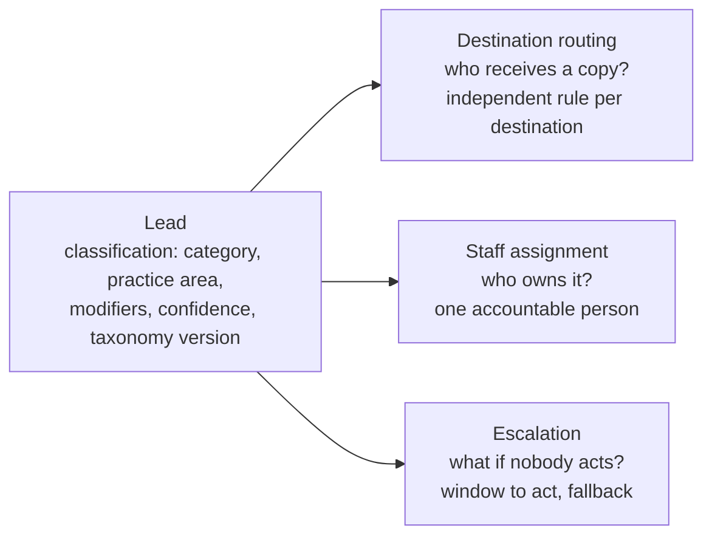

# RFC-009: Routing by Call Category

**Answering AI — Product and Technical Proposal**

**Date:** November 19, 2026
**Status:** Proposed — Awaiting stakeholder approval
**Decision owner:** Product / Engineering
**Reviewers:** Onboarding, Operations, Customer Success, Engineering
**Related:** RFC-001 (escalation: the window to act and the fallback) · RFC-002 (the taxonomy and the firm mapping) · RFC-005 (revisions and approval) · RFC-007 (slice 4) · RFC-008 (§5.2 the revision a delivery uses, §6 classification under uncertainty)
**Detail:** [routing-equivalence.json](../lead-delivery/routing-equivalence.json) (`python tools/routing_equivalence.py`) · [answers](../lead-delivery/answers.md#routing-and-integrations) · [discovery S11–S13](../discovery/scenarios.md#routing)

---

## 1. Executive Summary

Routing is decided today by matching the call type's free text against a firm's
*active contact types*, one switch for all its CRMs together. RFC-002 decided
that routing should go by call category, per destination, with a default that
reproduces today. This RFC checks that claim against every imported firm, and
specifies the routing decision so it can be built in slice 4.

**The check:** for **117 of the 122** active firms with a CRM connection, the
default rule ("CRMs take new matters") sends exactly what their active call
types send today. The other five need no richer rule language: three are
classification errors, one firm wants existing clients in its CRM, one has
"general" labels that disagree, and three call types are line-handling or
named-person variants of a new-client call.

**We propose** a small, closed routing rule per destination; a **routing
decision** recorded for every lead and destination, separate from the delivery
that follows it; and three concerns kept apart: **destination routing** (who
receives a copy), **staff assignment** (who owns the lead) and **escalation**
(what happens if nobody acts).

### Recommended decision

Approve:

1. The **routing rule**: call categories, practice areas, chat leads yes or no. No ordering, no free text, no per-label exceptions.
2. The **routing decision** as its own record, reproducible from the lead's classification, the revision and the taxonomy version.
3. **Seeding every firm's rule from today's active call types**, confirmed with the firm's mapping (RFC-002 §5.2); the five that differ reviewed by Onboarding first.
4. **Staff assignment out of routing**: a separate concern, specified later with the staff directory.

---

## 2. Problem Statement

### 2.1 What decides routing today

| | Today (api-2, [production-today](../lead-delivery/production-today.md)) |
|---|---|
| **Input** | The call type's text, trimmed and lowercased |
| **Rule** | One list of active contact types per firm, shared by every CRM |
| **Other destinations** | Email and the portal take everything; no rule |
| **Record** | None when a CRM is not sent a lead |
| **Meaning lost** | Category, practice area, urgency, confidence: none is read |

The call-type field also holds billing flags, staff names and phone handling
([RFC-002 §2](002_call_categories.md#2-problem-statement)), so a routing rule
over it mixes four jobs.

### 2.2 What the equivalence check found

Run over the imported api-2 firms (call types, not leads: the import holds no
lead volume):

| Verdict for the firm's CRMs | Active firms |
|---|---|
| **Default**: exactly new matters, every practice area | **117** |
| A category or practice area split between active and inactive call types | 4 |
| New matters limited to some practice areas | 1 |
| Nothing reaches the CRM today (no active types) | 0 |

Reading the five by hand:

| Cause | Call types | Fix |
|---|---|---|
| **Misclassified**: "*In Custody Calls" read as family law (custody), *fixed: "in custody" is now a jail call, reference lead `jail-in-custody-phrase`*; "*Verify Employment" and "*NOT IN NYC, WC, MASS" read as new matters | 3 | The taxonomy (a rule change, reference lead first) and the firm's mapping, not the routing rule |
| **Line handling** on a new-client call ("Away patch new clients", a weekday patch schedule) | 2 | Line settings (RFC-002 §5.3); open question 6.1 |
| **Named person** on a new-client call | 1 | Staff assignment (section 3.3) |
| **Existing clients** sent to the CRM, with an internal entry (`system`) also active, at one firm | 2 | A rule that adds `existing-client`; the `system` entry moves to account settings (RFC-002 §5.3) |
| **Several "general" labels**, some active and some not, at one firm | — | The firm decides whether `general` goes to its CRM; a split means its labels need confirming |

Only **2 active firms** have an *enabled* CRM in this snapshot, and they are the
last two rows above. That supports [strategy 2.4](../lead-delivery/strategy.md#24-the-integration-strategy-rests-on-an-untested-assumption)
and must be measured on the production feed before effort is sized.

**The lab differs from production on one rule.** Production sends nothing to a
firm's CRMs when it has no active call types; the lab's `Dispatch.routingExclusion`
sends everything. No active CRM firm is affected today; the lab rule is
corrected with a scenario, or retired by this RFC.

---

## 3. Proposal: Three Concerns, One Classified Lead



| Concern | Question | Shape | Where specified |
|---|---|---|---|
| **Destination routing** | Who receives a copy? | Every destination whose rule matches, independently; no order | This RFC |
| **Staff assignment** | Who owns the lead? | Exactly one person; an ordered rule is acceptable here | Later, with the staff directory (RFC-002 §5.3) |
| **Escalation** | What if nobody acts? | Timers by category; the fallback; acknowledgement | RFC-001, RFC-008 §3 |

Mixing them is the failure the call-type field shows: a staff name and a kind of
call in one label, and a CRM switch standing in for "this is a new client".

### 3.1 The routing rule

Part of a destination's **revision** (RFC-005), approved by the firm contact:

```
categories:     [new-matter]                      + the firm's choice of general, jail-custody, ...
practice areas: all | [personal-injury, criminal, ...]   (new matters only)
chat leads:     yes | no
```

Defaults ([answers](../lead-delivery/answers.md#routing-and-integrations)):
CRMs take new matters; email and the portal take everything; emergencies and
custody also go by SMS.

What it deliberately cannot say: an order of rules, a match on the firm's
label, a time of day, a named person. The check found no firm that needs them
once its call types are classified correctly. A need that appears later is
added as one field, in a new revision format, with a scenario.

### 3.2 The routing decision

One record per lead and destination, made once when the lead is recorded
(RFC-008 §5.2), before and apart from any delivery:

| Field | Holds |
|---|---|
| Lead, destination, firm, test | Identity |
| **Revision** and **taxonomy version** | What the decision was made against |
| **Classification used** | Category, practice area, confidence, and the plausible categories when uncertain |
| **Outcome** | **Planned** (a delivery follows) · **Not sent: routing** (the rule excludes it) · **Not sent: lead problem** (the lead lacks what the destination requires) |
| **Matched on** / **reason** | The category that matched, or why not, in the firm's words |

The **delivery** then has its own states (queued, retrying, held, accepted,
refused, gave up, unknown). A lead the firm chose to exclude is never shown as
a failure, and a failure is never shown as a choice.

Destination state is **not** a routing outcome. A paused destination or one
that needs reconnection still gets **Planned**; its delivery is **held**
(RFC-001), and the hand-off goes to the fallback. A live revision cannot have
an invalid configuration, because setup checks block go-live; a configuration
the receiver refuses is a delivery failure of class *configuration*.

### 3.3 Invariants

| # | Invariant | Status |
|---|---|---|
| 1 | Each destination's rule is evaluated on its own: no order, no first match, no destination's result changes another's | Proposed |
| 2 | Every usual destination of the firm gets a routing decision for every production lead | Lab (as `skipped`); Proposed as its own record |
| 3 | A decision is reproducible from the lead's classification, the revision and the taxonomy version it records | Proposed |
| 4 | Uncertainty widens within the firm's own usual destinations only: a destination is planned if its rule matches **any** plausible category (RFC-008 §6.1). It never reaches the fallback or another firm | Proposed |
| 5 | Free text never decides. A label routes only through the firm's confirmed mapping to a category | Proposed |
| 6 | A lead excluded at every destination owes no hand-off and never goes to the fallback | Lab |
| 7 | Planned and accepted are not acknowledged, and not assigned: a CRM's 200 is not a person following up (RFC-008 §3) | Proposed |
| 8 | A correction never re-routes past leads; it offers "send to the destinations it now matches" (RFC-008 §6.2) | Proposed |

---

## 4. Rollout

Slice 4 of [RFC-007](007_domain_model_and_build_order.md#8-build-order-thirteen-vertical-slices),
in its method's order:

| Step | Deliver |
|---|---|
| **Words** | GLOSSARY: *routing decision*, *planned*, *plausible categories*; *routing rule* gains practice areas. *Not sent* and *held* unchanged |
| **Scenarios** | `default-routing-equals-today`, `practice-area-filter`, `uncertain-routes-wide`, `excluded-everywhere-no-fallback`, `paused-destination-planned-and-held`; `routing-change-during-outage` exists |
| **Pure decision** | `route : rule → classification → decision`, replacing `Dispatch.routingExclusion`; tested on the reference leads |
| **Persistence** | The rule on the revision; the decision as its own record; the firm mapping (call type → category, confirmed) |
| **Seeding** | Each firm's rule derived from its active call types by the equivalence check; the five that differ reviewed by Onboarding; the taxonomy fixes of 2.2 made first |
| **Contract, screens** | [api.md](../api.md) first; the rule in plain words in setup and change requests; every *not sent* in the Delivery Center with its reason and revision |

Before seeding production, rerun the check on the production feed, weighted by
leads, not call types.

### Out of scope

- Staff assignment and the staff directory (section 3; a later RFC).
- A visual rule editor: the record and contract come first; the editor reads them.
- Referral of calls a firm does not take (RFC-002 §7).

---

## 5. Success Criteria

| Metric | Target |
|---|---|
| Firms whose seeded rule sends exactly what today sends, or whose difference they approved | 100% before switch-over |
| Leads with a routing decision at every usual destination | 100% |
| *Not sent* decisions with a reason and a revision | 100% |
| Firm questions "why didn't my CRM get this lead?" answered from the record alone | Every one |
| Leads routed by free text | Zero after switch-over |

---

## 6. Key Risks and Mitigations

**The sample is small and old.** 122 firms, call types not leads. *Mitigation:* rerun on the production feed, weighted by leads, before seeding.

**Classification errors route leads wrongly.** *Mitigation:* the firm confirms its mapping; uncertainty routes wide (invariant 4); corrections update the mapping for future leads.

**Firms need more than categories.** *Mitigation:* the discovery questions in 6.1; a field is added only with a scenario and a firm that needs it.

### 6.1 Open questions

| # | Question | Evidence so far | Who |
|---|---|---|---|
| Q1 | Should line handling (after hours, away, patch) change **routing**, or only urgency and the channel? | 2 call types at 2 firms | Five firms ([S11–S12](../discovery/scenarios.md#routing)) |
| Q2 | How should a call for a named person reach that person? | 1 new-client call type; 9.8% of all call-type names are people | Staff assignment RFC ([S13](../discovery/scenarios.md#routing)) |
| Q3 | Do firms want "new matters to the CRM, the rest by email"? | Matches 117 of 122 configurations | Five firms ([strategy](../lead-delivery/strategy.md#8-what-we-know-what-we-assume-and-how-we-check)) |

---

## 7. Decisions and Approval Request

| # | Decision | Proposed resolution |
|---|---|---|
| D1 | Rule shape | Categories, practice areas, chat leads; no order, no labels |
| D2 | Decision record | One per lead and destination, apart from the delivery; reproducible |
| D3 | Three concerns | Destination routing, staff assignment and escalation specified and built apart |
| D4 | Uncertainty | Wider only within the firm's usual destinations; never the fallback |
| D5 | Migration | Seed from active call types; review differences; confirm with the mapping |
| D6 | Order | Record and contract before any rule editor |

---

## Final Recommendation

**Route on what the call was, not on what it was called; record every decision, and keep who gets a copy, who owns it and who is chased apart.**
