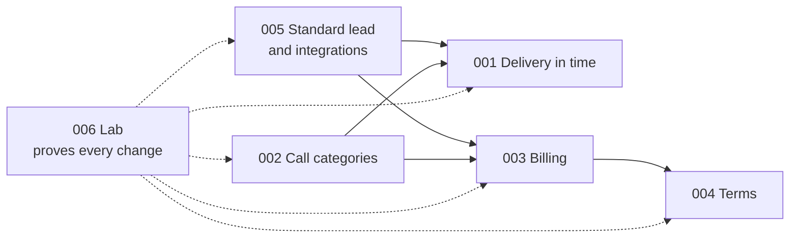

# RFCs

The proposals for approval. Each states the problem, the proposal, the rollout,
how success is measured, the risks, and the decisions it asks stakeholders to
approve. The depth behind each lives in the docs it links to; the decisions,
with why and what would change them, live in
[answers.md](../lead-delivery/answers.md).

| RFC | Title | Decision owner | Asks for |
|---|---|---|---|
| [001](001_lead_delivery_in_time.md) | Every Lead to the Firm, in Time | Product / Engineering | Measurement now; windows to act, fallback, held deliveries, failure classes; a lead delivery owner |
| [002](002_call_categories.md) | Call Categories as the Standard Language of a Call | Product | The taxonomy as company standard; classification at intake; the weekly firm report |
| [003](003_billing_on_value.md) | Billing on Value | Finance / Product | Three packages per handled conversation; one usage record; shadow billing, then switch |
| [004](004_terms_of_service.md) | Terms of Service Versions and Acceptance | Legal / Product | Scoped acceptance with notice; one version; a permanent record |
| [005](005_standard_lead_and_integrations.md) | One Standard Lead and the Integration Platform | Product / Engineering | One lead and contract; native integrations certified one at a time; setup and change by approval |
| [006](006_integration_lab.md) | The Integration Lab | Engineering | The lab as proving ground; an anonymised production feed; automatic checks |
| [007](007_domain_model_and_build_order.md) | The Domain Model and the Order to Build It | Engineering / Product | Nine bounded contexts; the hand-off as an aggregate; classification at intake; billing from conversations; thirteen slices and one method per feature; six guarantees any implementation keeps; scenarios and receiver contracts as language-neutral files |
| [008](008_delivery_guarantees_and_evidence.md) | Delivery Guarantees, Concurrency and End-to-End Evidence | Engineering / Product | Evidence levels and the two-level number; honest guarantees at each boundary; desired state and observed health; a classification policy; security and failure-injection gates; revises RFC-007's build order |

## How they fit together

- **Call categories** (002) set each lead's window to act and routing (001), and billing's free-call rules (003).
- **The standard lead** (005) carries the category and hand-off that delivery (001) and billing (003) read; its setup and change workflow approves fallbacks (001) and category routing (002).
- **Price changes** (003) reach firms as a terms version that firm admins accept (004).
- **The lab** (006) is where each is built and proven before production.
- **The domain model** (007) is the shape all six share: the contexts each belongs to, and the order their features depend on each other.

## Order

The build follows RFC-007's slices, grouped into the milestones of the
[roadmap](../lead-delivery/strategy.md#5-roadmap). Each RFC lands in these:

| Milestone | Slices | RFCs |
|---|---|---|
| Measure | Alongside 0 | 006 (the production feed) |
| 1. Reliable delivery | 0–3 | 007 (foundation, guarantees, contracts), 008 (real intake, leases, security gates, one CRM certified), 001 (decisions, retries, destination state), 006 (scenarios) |
| 2. In time, with approval | 4–6 | 002 (categories, routing), 005 (setup and change), 001 (window, fallback, held), 008 (evidence levels, escalation) |
| 3. Proof, CRMs and classification | 7–9 | 005 (the other CRMs), 001 and 002 (firm report), 002 and 008 (classification at intake, its decision policy) |
| 4. Billing and terms | 10–11 | 003, 004 |
| 5. Self-serve and platform | 12 | 005 (self-serve, contract, Zapier), 002 (benchmarks) |

The leadership version of all six is [vision-meeting/](../vision-meeting/README.md),
with a [one-page summary](../vision-meeting/summary.md).
